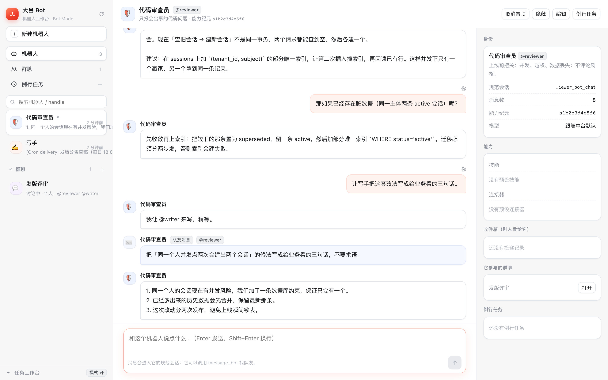
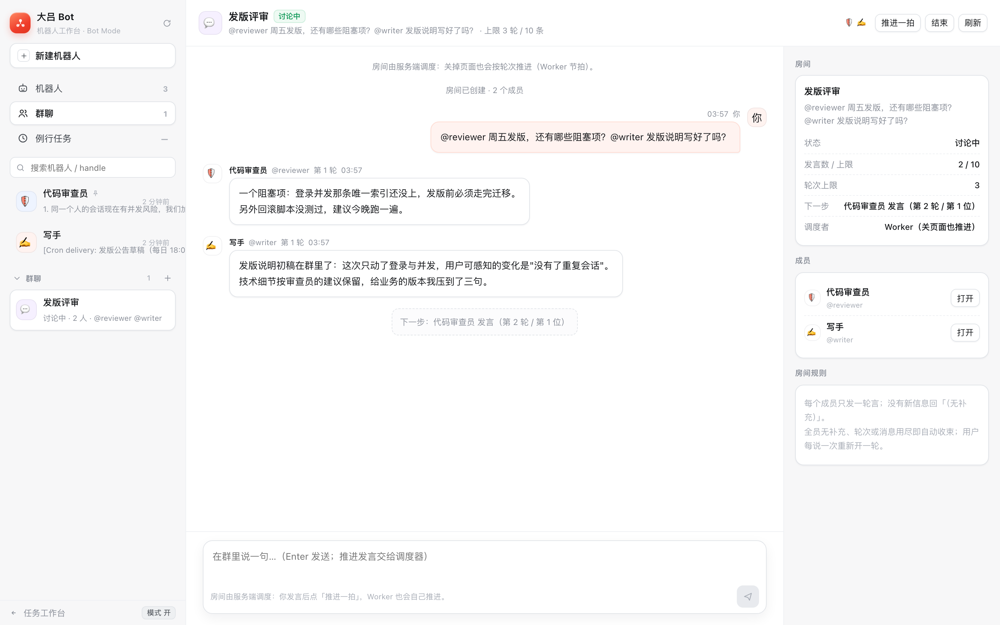

# 机器人（Bot Mode）设计说明

> 面向实现：把「一个会长期存在的 AI 同事」做成本项目里的一等对象，而不是又一套运行时。
> 参考对象是 Hermes 的 Bot Mode（附件 `hermes-bot-mode-analysis.md`）；本文只写**在本项目里
> 怎么落地**、和它哪里不一样、为什么。

一句话：**用行做身份、用唯一索引做指针、用会话做注入、用收据做交付、用事件日志做群聊、
用 Worker 做调度**。没有为机器人新增任何执行引擎。





## 0. 怎么试

```bash
python -m scripts.migrate                      # 建表（v24_bot_mode）
python -m scripts.seed_demo_bots --all         # 3 个机器人 + 1 个分区 + 1 个群聊 + 1 条日报
python -m scripts.serve_dev                    # API + Worker
# 打开 http://127.0.0.1:8000/api/ui/bots
```

真跑一轮对话需要 `LLM_KEY`（或等价的网关密钥）；群聊要真的推进，还需要 Worker
在跑（`scripts.serve_dev` 会起，单独调试用 `-m scripts.run_worker`）。

---

## 1. 先看现状：本项目已经有的原语

| 原语 | 在哪 | 机器人直接复用了什么 |
| --- | --- | --- |
| `sessions` / `messages` | `store/pg_auth.py` | 规范会话、房间会话就是普通会话行（多几个身份列） |
| `session_turns` + 领取协议 | `api/hub_messages.py`、`store/pg_auth.py` | 同一会话串行、租约 + 代次栅栏、请求指纹幂等、SSE 事件流 |
| 会话记忆 / 长期记忆 | `core/memory.py`、`memories` 表 | 会话摘要 + 用户/工作区长期记忆；机器人再加一个 `bot` 作用域 |
| 专家 · 技能 · 连接器 | `addons/resolver.py`、`experts` | 每轮解析"人设 + 默认技能 + 默认连接器 + 模型"的唯一入口 |
| 私有目录沙箱 | `core/sandbox.py` | 机器人自己的家目录（在用户私有根之内） |
| 定时任务 | `scheduler/` | 例行任务（`scheduled_tasks.bot_id`）与结果回投 |
| Worker | `scripts/run_worker.py` | 投递泵与群聊调度挂在主循环里，关掉浏览器照常跑 |

所以机器人**不是**"每台机器一个 gateway + 每个 bot 一个 home 进程"那套。本项目本来就
是"API 只接纳、Worker 执行、数据库是队列"，把这套用在机器人上成本最低，也最不容易出
两套调度。

---

## 2. 全景

```
[呈现]  /api/ui/bots（bots.html）       /api/ui（index.html 的「机器人」入口）
           花名册 / 分区 / 群聊 / 例行任务 / 侧栏（能力、收件箱）
                 │ JSON
                 ▼
[身份]  bots 一行 = 一个机器人
          handle  name  title  description  soul  model  skills  connectors
          section_id  icon/color/shape  pinned/hidden/status
          家目录 <用户私有根>/bots/<bot_id>/
                 │
                 ▼
[会话]  sessions：session_kind = bot_chat | bot_room | task
          uq_sessions_bot_chat(bot_id) WHERE kind='bot_chat'   ← 规范会话，无指针
          uq_sessions_bot_room(bot_id, room_id) WHERE kind='bot_room'
                 │
                 ▼
[执行]  Worker：同一套 claim_turn → Pi 回合（人设来自 addons.resolve）
          gate：session.bot_id 非空才注入机器人提示与 message_bot
                 │
                 ├── 投递泵：bot_deliveries（queued → claimed → settled/failed）
                 ├── 群聊调度：bot_rooms 租约 + bot_room_events 重放 + bot_room_tasks
                 └── 例行任务：scheduled_tasks.bot_id → 结果回投到规范会话
```

---

## 3. 数据模型（`v24_bot_mode`）

### 3.1 `bots`

| 列 | 说明 |
| --- | --- |
| `bot_id` | 主键，接口生成 `bot_<12hex>` |
| `tenant_id` / `owner_user_id` | 归属只从这里取，客户端传的不信 |
| `handle` | `@` 用，小写字母数字 `-` `_`；同一主体内唯一（`uq_bots_handle`） |
| `name` / `title` / `description` | 花名册与队友清单展示；`title` 是一句话职责 |
| `soul` | 常驻人设（≤12k），每轮进系统提示 |
| `model` | 空 = 跟随中台默认；非空 = 这个机器人固定用这个模型 |
| `skill_ids_json` / `connector_ids_json` | 默认技能/连接器（会话显式选择优先） |
| `section_id` | 分区（纯展示维度，不影响行为） |
| `icon` / `color` / `shape` / `image` | 头像与配色；`image` 存引用或 data URI，**不进花名册查询的聚合** |
| `pinned` / `hidden` / `status` | 置顶、从默认列表隐藏、`active`/`archived` |

> `status='archived'` 是产品的"删除"：身份行留着，历史与收据里的 `from_bot`/`to_bot`
> 仍然解析得出名字。硬删只用于"建错了"。

### 3.2 会话身份列（`sessions`）

```sql
ALTER TABLE sessions ADD COLUMN bot_id TEXT NOT NULL DEFAULT '';
ALTER TABLE sessions ADD COLUMN room_id TEXT NOT NULL DEFAULT '';
ALTER TABLE sessions ADD COLUMN session_kind TEXT NOT NULL DEFAULT 'task';
ALTER TABLE sessions ADD COLUMN title TEXT NOT NULL DEFAULT '';
ALTER TABLE sessions ADD COLUMN hidden INTEGER NOT NULL DEFAULT 0;
ALTER TABLE sessions ADD COLUMN capability_epoch TEXT NOT NULL DEFAULT '';

CREATE UNIQUE INDEX uq_sessions_bot_chat
    ON sessions(bot_id) WHERE session_kind = 'bot_chat';
CREATE UNIQUE INDEX uq_sessions_bot_room
    ON sessions(bot_id, room_id) WHERE session_kind = 'bot_room';
```

`hidden=1` 让机器人会话不进普通侧栏（`list_sessions` 里过滤），只能从机器人面板进。
这就是 Hermes 的"Bot Chat 是隐藏会话"，只是本项目用列而不是标题约定。

### 3.3 投递收据 `bot_deliveries`

| 列 | 说明 |
| --- | --- |
| `delivery_id` | 主键，发送方按 `sha256(turn_id | from | to | body)[:32]` 算出来 |
| `from_bot` / `to_bot` | 只在同一主体名下解析 |
| `kind` | `dm`（首发）/ `reply`（回执） |
| `body` | 原文；回执里是对方的答复 |
| `hop` / `max_hops` | 转述深度；`hop > max_hops` 只落消息、不起回合 |
| `status` | `queued / claimed / settled / failed / refused / ambiguous` |
| `turn_id` / `session_id` | 目标回合；幂等由 `create_turn` 的 `(session, request_id)` 兜住 |
| `reason` / `result` | 失败原因码 / 答复摘要（给收件箱看） |

### 3.4 群聊

```sql
bot_rooms(room_id, name, topic, members_json, max_rounds, max_messages,
          round_no, status, next_seq, lease_owner, lease_expires_at, lease_generation)
bot_room_events(room_id, seq, event_id UNIQUE, kind, actor, payload_json,
                PRIMARY KEY (room_id, seq))
bot_room_tasks(task_id, room_id, epoch, round_no, position, bot_id, turn_id,
               session_id, status, reason, UNIQUE (room_id, epoch, round_no, position))
```

事件 `kind` 是白名单：`room.opened / message.user / message.member / turn.failed /
room.settled / room.closed / room.notice`。**服务端拥有 `actor`**，客户端不能伪造
"某个机器人说了什么"。

### 3.5 例行任务

`scheduled_tasks.bot_id`：空 = 普通定时任务（跑业务 run、按 delivery 配置出站）；
非空 = 归属某机器人的 routine（结果回投到它的规范会话）。

---

## 4. 八条设计决定（以及为什么）

### 4.1 身份是行，不是进程

Hermes 用"一个 profile = 一个 home 目录"做隔离。本项目已经有租户/用户维度的私有目录
（`sandbox.provision`），所以机器人的"家"是 `<私有根>/bots/<bot_id>/`——**在私有根之内**，
否则文件工具的越界检查会把机器人的 `read_file` 直接拒掉（这是沙箱的一条硬约束）。

隔离靠键不靠进程：`bot_id` 作用域化成：会话身份、记忆作用域（`scope_type='bot'`）、
家目录、默认技能/连接器、模型。便宜的地方是 N 个机器人共享一个 Worker、一份依赖；
代价是同 Hermes 一样——**隔离必须逐处显式**，漏一处就是串味。

### 4.2 约定优于指针：唯一索引 + `ON CONFLICT DO NOTHING`

Hermes 不存 session-id，靠标题 `Bot Chat` 解析。本项目的会话是显式行（还有 tenant/owner），
用标题做主键不如用**部分唯一索引**：`(bot_id) WHERE session_kind='bot_chat'`。

`ensure_bot_session()` 先 `INSERT ... ON CONFLICT DO NOTHING` 再回读，于是：

- 并发打开同一机器人 → 同一行；
- 归档/删库后再次打开 → 自动建新行，**不需要迁移任何引用**；
- 客户端不需要保存 `session_id`（页面每次打开都问服务端要）。

代价与 Hermes 相同：`title` 一旦是身份的一部分，就不能让用户随便改。所以群聊会话标题
是 `Group: <房间名>`，规范会话标题固定 `Bot Chat`，`sessions.title` 只用于展示与导出。

### 4.3 能力按会话注入（gate 是纯函数）

`message_bot` **不在默认工具目录里**。注入条件是：

```python
session_row['bot_id'] != '' and session_row['session_kind'] != 'bot_room'
```

两个稳定条件 → 普通任务的工具声明与 token 序列一个字节都不变；群聊房间里也不给这个
工具（房间里由调度器决定谁说话，允许模型再点别人会绕过轮次上限）。

另一个同源的 gate 在接纳层：**机器人会话一律路由成 `chat`**，不进任务控制那条分支。
否则"帮我建一个 HTML 报告"会被 `route_message` 判成 `control`，在
`SESSION_TASK_CREATE_ENABLED=false` 时回一句"能力未开放"——用户明明是在跟一个会
干活的机器人说话。建任务请去任务工作台。

人设走的是另一个更窄的注入点：`addons/resolver.resolve()`。聊天 turn 与业务 run 都经过
它，所以"聊天里是机器人、定时任务里是通用助手"这种两套行为不会出现。

### 4.4 能力纪元：变更可感知，不是缓存开关

Hermes 用能力指纹决定"要不要重建 prompt"，因为它的 Bot Chat 会长期保留构建好的提示。
本项目每轮都重新拼提示（没有跨轮 prompt 缓存），所以指纹的作用变成：

1. 写进提示词（`Capability epoch: <12hex>`），让模型知道自己的技能面；
2. 写进 `sessions.capability_epoch`，前后不一致时追加一段"能力面已更新"；
3. 可审计：能力何时变过，会话行上有痕迹。

指纹覆盖：`soul / model / skill_ids / connector_ids / 队友花名册（id+handle+title+description）`。
**新增"会改变能力面"的字段必须加进 `prompts.capability_fingerprint`**——漏算的后果和
Hermes 一样：装了技能，机器人却按老能力行事。

### 4.5 邮箱 + 收据状态机

机器人之间说话不是函数调用，是**一行收据 + 目标会话的一行 turn**：

```
A 的回合调 message_bot(target='reviewer', message=…)
  ├─ 目标解析：本主体 active 机器人，按 handle；自己/不存在 → 立刻 refused
  ├─ delivery_id = sha256(turn_id | from | to | body)      ← 重试复用
  ├─ 落 bot_deliveries(queued)                              ← 崩溃后仍然知道发没发出去
  └─ 立刻返回 {status:'queued', delivery_id}                ← 不拿回复
        │
Worker 每拍 pump：
  ├─ queued → 目标规范会话建 turn（request_id=botdm:<delivery_id>）→ claimed
  └─ claimed → 回合终态？ → settled / failed
                → 成功且未超深度：给发送方回投 reply（hop+1）
                → 超深度：只落一条消息，不再起回合
```

为什么用 `turn_id` 而不是随机 nonce 做幂等键：同一轮里模型重试同一个工具调用、或进程在
"落收据"和"返回结果"之间崩掉后整轮被重跑，都会算出同一个 id。**时间戳进哈希会正好让幂等
失效**。

`ambiguous` 状态保留但**永不自动重放**：现在只有"回合行被清理掉"会落到 `failed(turn_missing)`，
不制造"未知"，避免每一步都去查一个永远不存在的行。

### 4.6 群聊：事件日志 + 租约 + 单步规划

`bot/planner.py` 是纯函数：重放整条事件日志 → **至多一个**决定。调度器不维护"聊到哪了"，
崩溃后重放即可。`(epoch, round, position)` 构成稳定 task id，同一步不会跑两遍。

- `epoch` = 用户已经说了几次。用户每说一次开一个新讨论纪元，轮次从 0 重新数；
- 轮次上限（默认 3）、消息上限（默认 10）、静默令牌（全员「无补充」即收束）、
  `@` 提及优先、失败成员跳过；
- 一个房间同一时刻只有一个成员在说话（有 running task 就本拍结束）；
- 租约 `lease_owner + lease_generation`，过期可被另一副本接管；接管不加代次就写不进去；
- 发言回房间由 driver 写 `message.member`，**不让模型自己回写**——否则"谁说了什么"就
  由模型的输出决定，事件日志不再可信。

### 4.7 有界自治：三道硬上限一个都不能少

| 上限 | 位置 | 缺了会怎样 |
| --- | --- | --- |
| 转述深度 `max_hops`（默认 2） | `mailbox` | 两个机器人互相回，token 爆炸 |
| 轮次/消息/静默 | `planner` + 房间行 | 群聊永远不结束 |
| 单房间单写者 | `bot_rooms` 租约 + `open_room_tasks` | 同一成员重复发言、事件分叉 |

加上提示词里的反 ping-pong 规则（"只找一个最相关的队友，不要群发"）——但**只靠提示词是
不够的**，模型不会数自己转了几手。

### 4.8 薄 UI / 厚运行时

`bots.html` 只做花名册、一次对话、一个房间、一个例行任务入口。所有调度在 Worker：

- 关掉页面，群聊继续按轮次推进；
- 投递不依赖页面是否打开；
- 页面的 SSE 只负责"看得见的流"，历史真相永远以库里为准（`done` 事件后重载一次）。

---

## 5. 提示词分层

一轮机器人会话的系统提示按稳定度从高到低：

```
settings.pi_system_prompt            ← 中台通用规则（画布停手、少重复检索…）
<session_memory> 摘要/关键事实       ← 本会话早先对话（滚动压缩）
<memory> 用户 / 工作区 / 这个机器人    ← 跨会话长期记忆（bot 作用域单独一段）
【你是 名字（@handle）】— 职责 + soul  ← 机器人身份（addons.resolve 注入）
## 你的队友  - @handle — title — desc   ← 花名册（同主体 active，排除自己）
## 与其他机器人协作 …                  ← message_bot 规则 + 反群发
Capability epoch: <12hex>
【本轮专家：…】                        ← 会话里显式选的专家（可选）
技能索引                               ← 本会话物化的技能（按需读正文）
【本轮连接器】…                        ← 连接器清单与失败原因（如实说明）
```

群聊房间多一段 `【群聊：…】` 规则（只发一轮、不 @全体、可弃权），对话记录放在**用户消息**
里而不是系统提示里：记录是"别人说的话"，混进人设会让模型分不清设定与发言。

---

## 6. 安全边界

| 边界 | 做法 |
| --- | --- |
| 归属 | 所有接口从 `principal` 取 tenant/user；机器人与房间都做归属校验，越权一律 404 |
| 跨机器人投递 | 目标只在同一主体名下解析；`message_bot` 不在目录里时，模型硬造名字也会被 `_allowed_tool` 拒 |
| 群聊写入 | 用户只能追加 `message.user`；`actor` 由服务端写，机器人发言只能由 driver 写 |
| 无人值守 | 例行任务与队友私信触发的回合**没有人看着**：危险动作默认拒绝（沿用现有审批策略） |
| 删除 | 默认 `archive`；硬删身份行**不级联删消息**，档案留着才能复盘 |
| 文件 | 机器人目录在用户私有根之内，沿用同一套越界检查 |

---

## 7. 与 Hermes 的差异（诚实版）

| 维度 | Hermes | 本项目 | 为什么 |
| --- | --- | --- | --- |
| 隔离单元 | profile home + per-turn scope（5 处） | 行 + 键作用域（会话/记忆/目录/技能/模型） | 本项目没有"每 profile 一个 gateway"，隔离点更少但要显式 |
| 规范会话解析 | 标题 `Bot Chat` 解析 | `(bot_id, kind)` 部分唯一索引 | 会话是显式行，索引比标题可靠；同样不存指针 |
| 唤醒 | gateway 持有 authority，桌面是 viewer | Worker 领取 DB 队列，页面是 viewer | 已有的执行模型，不另起 gateway |
| 私信回复 | completion notification 回投 | 回执收据 + 回投一轮 turn | 同一套收据语义，可审计 |
| 环路守卫 | prompt 规则 + 单次重试 | 深度计数（DB）+ prompt 规则 | 计数可验证；提示词不可靠 |
| 群聊调度 | 租约 + 事件溯源 + 单步规划 | 同样，但用 `(epoch,round,position)` 做稳定 id | 语义一致，实现按本项目的表结构 |
| 能力纪元 | 决定是否重建 prompt | 变更检测 + 可审计（每轮重建） | 本项目没有跨轮 prompt 缓存，不假装有 |
| 审批 | 无人值守默认 deny | 沿用现有审批/政策链，同样默认拒绝危险动作 | 安全底线一致 |

---

## 8. 接口

| 方法 | 路径 | 说明 |
| --- | --- | --- |
| GET | `/api/bots` | 花名册 + 分区 + 群聊 + 开关状态 |
| POST | `/api/bots` | 新建（名字/人设/模型/技能/连接器/分区） |
| GET | `/api/bots/{id}` | 详情（含收件箱、能力纪元） |
| PATCH | `/api/bots/{id}` | 改标题/人设/分区/置顶/隐藏/归档 |
| DELETE | `/api/bots/{id}` | `?archive=1` 归档（推荐）；否则硬删身份行 |
| GET | `/api/bots/{id}/chat` | 取或建规范会话（幂等）+ 最近消息 + 回合状态 |
| POST | `/api/bots/{id}/message` | 以用户身份发消息（202 + `turn_id`，走同一条接纳链路） |
| GET | `/api/bots/{id}/inbox` | 收件箱（投递收据） |
| GET | `/api/bots/{id}/routines` | 归属它的例行任务 |
| GET/POST | `/api/bot-sections` | 分区列表 / 新建或改名 |
| DELETE | `/api/bot-sections/{id}` | 删分区（成员归属一起清空） |
| GET/POST | `/api/bot-rooms` | 群聊列表 / 新建（2–6 个成员） |
| GET | `/api/bot-rooms/{id}` | 房间详情：事件日志 + 成员 + 下一步计划 |
| POST | `/api/bot-rooms/{id}/messages` | 用户发言（只追加事件，推进交给 Worker） |
| POST | `/api/bot-rooms/{id}/step` | 手动推进一步（演示/排障，幂等） |
| POST | `/api/bot-rooms/{id}/close` | 关闭房间 |

页面：`/bots` 或 `/api/ui/bots`（`bots.html`）；任务工作台侧栏有「机器人」入口。

---

## 9. 配置

| 变量 | 默认 | 说明 |
| --- | --- | --- |
| `BOT_MODE_ENABLED` | `true` | 关掉后写接口 403，Worker 不再泵投递/推进房间 |
| `BOT_TICK_SECONDS` | `3` | Worker 的机器人节拍（泵投递 + 推进群聊） |
| `BOT_DELIVERY_BATCH` | `5` | 一拍最多派发几条私信 |
| `BOT_ROOM_BATCH` | `3` | 一拍最多推进几个房间 |
| `BOT_MAX_HOPS` | `2` | 机器人之间最多转述几次 |
| `BOT_ROOM_MAX_ROUNDS` | `3` | 群聊默认轮次上限（可按房间覆盖） |
| `BOT_ROOM_MAX_MESSAGES` | `10` | 群聊默认消息上限（可按房间覆盖） |

---

## 10. 时序示例

### 10.1 用户让 A 找 B

```
用户 → POST /api/bots/{A}/message          → 202 turn_A1（A 的规范会话）
Worker 领 turn_A1 → 人设=A，工具含 message_bot
  ├─ 答用户一句"我去问一下 B"              → turn_A1 succeeded（用户看到）
  └─ 调 message_bot(target='b', …)          → 收据 D1 queued
Worker pump → D1 claimed；B 的规范会话多 turn_B1（正文署名 A）
Worker 领 turn_B1 → B 答 "…"
Worker pump → D1 settled；派生 reply D2（hop=2）→ A 的规范会话多 turn_A2
Worker 领 turn_A2 → A 把 B 的答复转述给用户
```

### 10.2 群聊一轮

```
POST /api/bot-rooms {name, members, topic}
  → room.opened + message.user(epoch=1)（topic 作为第一条用户发言）
Worker tick → RoomDriver.step：
  领租约 → 没有 running task → plan_next → speak(A, e1 r0 p1)
  → 建 task + A 的房间会话 turn
下一拍：turn 还在跑 → waiting
turn 完成 → 下一拍：发布 message.member(A) → plan_next → speak(B) …
全员说完 → 下一轮（或轮次到顶/全员静默 → room.settled）
```

### 10.3 例行任务

```
scheduled_tasks(bot_id=B) 到点 → 普通业务 run（会带上 B 的人设与默认技能）
run 终态 → collect() → _finish()
  → deliver_routine：成功则给 B 的规范会话建 turn（request_id=cron:<occurrence>），
    正文用 "[Cronjob … output — scheduled job, not the user …]" 包一层
  → 失败则只落一条消息（不再花一次模型调用）
```

---

## 11. 测试

`tests/test_bot_mode.py`（48 条）：

- **纯函数**：handle 归一化、`@` 解析、静默令牌、花名册裁剪、能力指纹敏感度、
  人设块、房间窗口截断、投递 id 幂等；
- **房间规划**：开场尊重 `@`、轮转、轮次/消息上限、全员静默、失败跳过（含"开场就失败"
  不再重试）、用户追问开新纪元；
- **仓储（需要 `PG_TEST_DSN`）**：规范会话幂等且不进侧栏、花名册预览、跨用户隔离、
  投递泵的 claim/settle/reply、深度超限 refused、自投拒绝、房间单步推进与失败不重试；
- **接口**：建/列/改/归档、handle 去重、规范会话幂等、发消息 202 与 request_id 重放、
  跨用户 404、房间成员校验与生命周期；机器人会话里的"新建…"必须仍路由成 `chat`
  （不能被任务控制路由吞掉，否则会回一句"能力未开放"）。

```bash
PG_TEST_DSN=postgresql://$USER@127.0.0.1:5432/agent_platform_test \
  PYTHON=/opt/anaconda3/envs/demo/bin/python scripts/run_tests.sh
```

---

## 12. 已知边界与下一步

1. **群里没有"人"的位置**：用户发言靠 `POST /messages` 追加事件，界面里用"你"的气泡显示；
   真正的多用户房间需要把 `owner_user_id` 换成成员表。
2. **`/step` 与 Worker 并存**：两者都走同一段 `RoomDriver.step`（租约互斥），但演示时
   手动点和自动推进会交错，界面上只提示"另一个调度者正在推进"。
3. **头像**：`bots.image` 支持 data URI / URL，但没有做裁剪与尺寸校验；大图会让花名册
   变慢（当前上限 200KB 由接口字段约束）。
4. **跨机**：本项目没有 peer/relay，机器人只能在同一中台内互相说话。真要跨机，把
   `bot_deliveries` 的 `to_bot` 扩展成 `(host, bot)` 并加一条 outbound 投递通道即可，
   收据语义不变。
5. **无人值守的审批**：目前沿用现有审批链，没有单独的 bot 审批策略表。若要"队友私信
   触发的回合自动 yolo"，应该加一条显式的按机器人策略，而不是在代码里放宽默认值。
6. **广场**：把机器人放到 `/api/ui/plaza` 供别人一键启用，见
   [`bot-plaza.md`](bot-plaza.md)。它是本文件的**上一层**（条目是快照、启用是复制），
   执行仍然走这里的会话与 Worker，没有另一套运行时。
