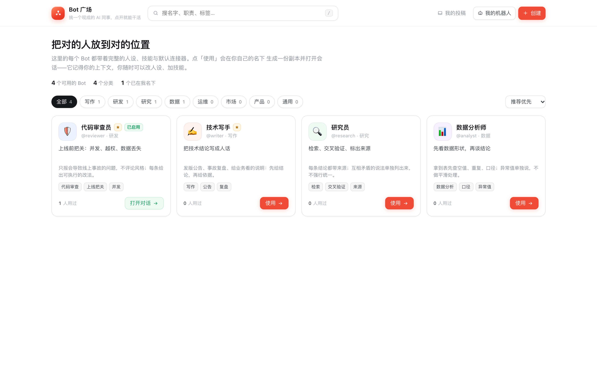

# Bot 广场设计说明

> 面向实现：让「别人调好的机器人」变成一次点击就能用的东西，而不是让每个用户从
> 空白人设开始重写一遍。
> 前置阅读：`docs/bot-mode.md`（机器人身份、规范会话、能力注入）。

一句话：**条目是发布那一刻的快照，启用是复制一份到我名下；广场只是入口，执行仍然
走原来那套 Worker。**



## 0. 怎么试

```bash
python -m scripts.migrate                       # 建表（v27_bot_plaza）
python -m scripts.seed_demo_plaza               # 4 条官方 Bot（公开可见）
python -m scripts.serve_dev                     # API + Worker，默认 8002
# 打开 http://127.0.0.1:8002/api/ui/plaza
```

工作台在 `/api/ui/bots`；控制台在 `/admin` 的「Bot 广场」页签。
换端口演示记得同步 `AUTH_ALLOWED_ORIGINS`（见 7.1）。

---

## 1. 三个对象，一条链路

```
投稿（用户）                    审核（管理员）                使用（用户）
bots 一行 ──publish──▶ bot_plaza_items ──published──▶ 点「使用」─▶ bots 新一行
  人设/技能/连接器          （快照 + 状态 + 分类）                       │
                                          └── install 登记 ──▶ 规范会话 + 家目录
```

广场**不引入新的执行路径**：点「使用」得到的就是一个普通机器人，之后的聊天、
投递、群聊、例行任务与手工创建的机器人完全一样。这样做的代价是数据多一份副本，
收益是"广场"这套东西出问题也影响不到正在干活的机器人。

---

## 2. 核心决定：快照而不用指针

最省事的做法是让条目只存 `bot_id`，展示时实时读那个机器人。**没有这么做**，原因是：

| 若用指针 | 后果 |
| --- | --- |
| 投稿人改了自己的人设 | 广场上所有人看到的版本跟着变，甚至变成完全不同用途的 Bot |
| 投稿人删了机器人 | 广场条目变成空壳，点「使用」报错 |
| 想给条目写一段"详细介绍" | 只能塞进机器人描述，污染它自己的花名册 |

所以 `bot_plaza_items` 存的是**发布那一刻的完整人设快照**（`soul` / `model` /
`skill_ids` / `connector_ids` / 头像配色），`source_bot_id` 只用于"它从哪来"的追溯
和工作台的"去原机器人看看"。要更新广场版本，投稿人**重新发布一次**：`version + 1`，
重新进评审。

同理，启用也是复制而不是引用：机器人必须活在用户自己的私有根下
（`<私有根>/bots/<bot_id>/`），记忆作用域也是按 `bot_id` 分的。跨账号共享同一份
身份，等于把两边的记忆和文件混在一起——那是另一个产品，不是这个。

---

## 3. 数据模型（`v27_bot_plaza`）

### 3.1 `bot_plaza_items`

| 列 | 说明 |
| --- | --- |
| `item_id` / `slug` | 主键（`plz_<12hex>`）/ URL 用的短名，全局唯一 |
| `source_bot_id` | 从哪个机器人投来的（可空：官方直接建） |
| `publisher_tenant` / `publisher_user_id` | 投稿方；官方条目写 `platform` |
| `name` / `handle` / `title` / `description` | 卡片与详情的主文案 |
| `soul` / `model` / `skill_ids_json` / `connector_ids_json` | 启用时复制过去的能力 |
| `icon` / `color` / `shape` / `image` | 头像与配色（同 `bots` 的字段语义） |
| `category` | 白名单见 `bot/plaza.py`，不合法一律落 `general` |
| `tags_json` / `readme` / `starters_json` | 标签、详细介绍、推荐开场白 |
| `scope` | `tenant`（只有发布方企业可见）/ `public`（全平台） |
| `status` | `draft / pending / published / rejected / offline` |
| `featured` / `position` | 运营位：推荐置顶与同级排序 |
| `install_count` / `view_count` | 累计启用次数（首次登记时 +1）/ 详情浏览量 |
| `review_note` / `reviewed_by` / `reviewed_at` | 审核痕迹；驳回理由就是这里 |
| `version` | 重新发布的版本号 |

### 3.2 `bot_plaza_installs`

| 列 | 说明 |
| --- | --- |
| `install_id` | 主键 |
| `item_id` + `tenant_id` + `owner_user_id` | **唯一**：一个人对同一条目只装一次 |
| `bot_id` | 副本机器人；空表示"登记了但机器人还没建出来"（崩溃留下的中间态） |
| `item_version` | 装的时候是哪个版本 |

`bot_id` 允许为空是为了崩溃安全：先 `INSERT ... ON CONFLICT DO NOTHING` 占位，
再建机器人、再回填。中间崩了，下次点「使用」会看到"有登记但没 bot"，于是补建并
回填同一个登记行——不会出现两个副本。

---

## 4. 状态机与两级权限

```
draft ──提交──▶ pending ──通过──▶ published ──下架──▶ offline
                   │                   ▲                 │
                   └──驳回──▶ rejected ─┴──重新提交───────┘
```

- **用户投稿**只能落 `tenant + pending`。跨企业可见是管理员的动作，不是投稿人的。
- **驳回必须写理由**（接口层强制）：`rejected` 没有 `review_note` 等于告诉投稿人
  "你自己猜"。
- `published` 是唯一会被 `/api/bot-plaza` 返回的状态；其余状态只在"我的投稿"和
  控制台里出现。
- 撤回 = `offline`，不删条目：已经装过的人不受影响，投稿历史也还在。

| 角色 | 能做什么 |
| --- | --- |
| 任何登录用户 | 浏览公开的 + 本企业已上架的条目；启用自己的副本；投稿/撤回自己的机器人 |
| `operator`（本企业运维） | 控制台里审核**本企业**投稿；**不能**把条目设成 `public` |
| `platform_admin` | 全部条目；跨企业上架；从任意机器人复制一份官方条目 |

越权一律 404 而不是 403：不泄露"别人有什么"。

---

## 5. 接口

| 方法 | 路径 | 说明 |
| --- | --- | --- |
| GET | `/api/bot-plaza` | 列表（分类计数、已装标记、`q`/`category`/`order`） |
| GET | `/api/bot-plaza/mine` | 我的投稿（含驳回理由）+ 我装过的 |
| GET | `/api/bot-plaza/{id}` | 详情（`soul` / `readme` / `starters`）；顺手 `view_count+1` |
| POST | `/api/bot-plaza/{id}/install` | **点「使用」**：幂等，返回 `bot_id` + `chat_url` |
| DELETE | `/api/bot-plaza/{id}/install` | 卸载：归档副本 + 删登记（历史消息留着） |
| DELETE | `/api/bot-plaza/mine/{id}` | 撤回自己的投稿 |
| POST | `/api/bots/{id}/publish` | 投稿/更新投稿（`version + 1`） |
| DELETE | `/api/bots/{id}/publish` | 撤回该机器人的投稿 |
| GET | `/api/console/plaza` | 控制台列表（operator 只看本企业）+ 状态计数 |
| POST | `/api/console/plaza` | 直接上架官方条目（可给 `source_bot_id` 复制） |
| PATCH | `/api/console/plaza/{id}` | 改内容 / 审核动作 / 推荐位 / 可见范围 |
| DELETE | `/api/console/plaza/{id}` | 删条目（不影响已装副本） |

页面：`/plaza` 或 `/api/ui/plaza`（`plaza.html`）；工作台右栏有「发布到广场」，
控制台有「Bot 广场」页签。

---

## 6. 前端的三处细节

1. **点「使用」直接进对话**：`install` 返回 `chat_url = /api/ui/bots?bot=<id>`，
   页面立刻跳过去。少一次"安装成功，请手动打开"的断点。
2. **推荐开场白带过去**：详情页把 `starters` 画成按钮，点一下跳到
   `/api/ui/bots?bot=<id>&say=<开场白>`，工作台把这句话**填进输入框但不自动发送**——
   用户还有机会改一个字。
3. **已装标记来自安装登记**，不来自机器人行上的标记：换设备、清缓存都一致；
   卸载后立刻变回「使用」。

---

## 7. 配置

| 变量 | 默认 | 说明 |
| --- | --- | --- |
| `BOT_PLAZA_ENABLED` | `true` | 关掉后投稿/启用接口 403，页面退化成"只看不装" |
| `BOT_PLAZA_PAGE_SIZE` | `60` | 一次列表最多回多少条 |

`BOT_MODE_ENABLED=false` 时广场一并关闭：没有机器人运行时，装了也跑不起来。

### 7.1 本地联调有个坑：端口必须进允许来源

「使用」「投稿」「审核」都是写请求，会过全局的 `guard_origin` 中间件
（`observe/runtime_check.py::origin_rejected`）。浏览器发 POST 一定带 `Origin`，
**只要 `AUTH_ALLOWED_ORIGINS` 非空且不含当前访问地址，一律 403「Origin 不在允许列表」**——
这跟广场无关，`POST /api/bots` 同样会 403，但表现上很像"点了使用没反应"：
页面停在广场，只在 toast 里闪一下。

`.env` 里默认只放了一对：`AUTH_ALLOWED_ORIGINS=http://127.0.0.1:8002,http://localhost:8002`。
所以换端口演示（比如 `--port 8011`）时必须同步改这一行，或者临时覆盖：

```bash
AUTH_MODE=off AUTH_ALLOWED_ORIGINS="http://127.0.0.1:8011,http://localhost:8011" \
  python -m scripts.serve_api --port 8011
```

curl 复现时不要漏掉 `-H "Origin: http://127.0.0.1:8011"`：不带 Origin 反而能过，
会得出"接口是好的"的错误结论。

---

## 8. 测试

`tests/test_bot_plaza.py`：

- **纯函数**：分类白名单回落、标签去重/上限、可见性（状态 × 范围 × 租户）、
  列表视图不带 `soul/readme`、详情视图带、`installed` 跟随 `bot_id`；
- **接口**（需要 `PG_TEST_DSN`）：投稿落 `pending` 且不进列表；重复投稿 `version+1`
  并重新进评审；驳回理由回到"我的投稿"；撤回变 `offline`；
  启用复制人设与技能、二次启用幂等、`install_count` 只加一次；卸载归档副本；
  未上架的条目不能启用；`tenant` 范围跨租户不可见、`public` 可见；
  普通成员进不了控制台；`operator` 不能设 `public`；投别人的机器人 404。

```bash
PG_TEST_DSN=postgresql://$USER@127.0.0.1:5432/agent_platform_test \
  PYTHON=/opt/anaconda3/envs/demo/bin/python scripts/run_tests.sh
```

---

## 9. 已知边界与下一步

1. **没有评分与评论**：`install_count` 只说明"被拿走过"，不说明"好用"。真要做得
   先解决"谁有资格评"（装过的人），否则广场会变成刷分场。
2. **没有版本升级提醒**：条目 `version + 1` 后，已装的副本不会收到通知——
   这是刻意的（不许别人的改动悄悄改我的机器人），但缺一个"有新版本，要不要同步"
   的入口。做的时候必须逐字段 diff，让用户勾选要同步哪几项。
3. **副本之间互不感知**：同一个条目装出 20 份，各自调教、各自演化。想做"企业内
   共享同一份"就是另一套模型（共享身份 + 权限），不是给广场加个开关能解决的。
4. **图片没有校验**：`image` 沿用 `bots` 的口径（data URI / URL，上限 200KB），
   没有裁剪与尺寸检查，大图会拖慢首屏。
5. **付费/配额**：目前不看积分也不限企业配额。要接的话入口在
   `install_plaza_bot()`——它是唯一会产生新机器人的地方。
