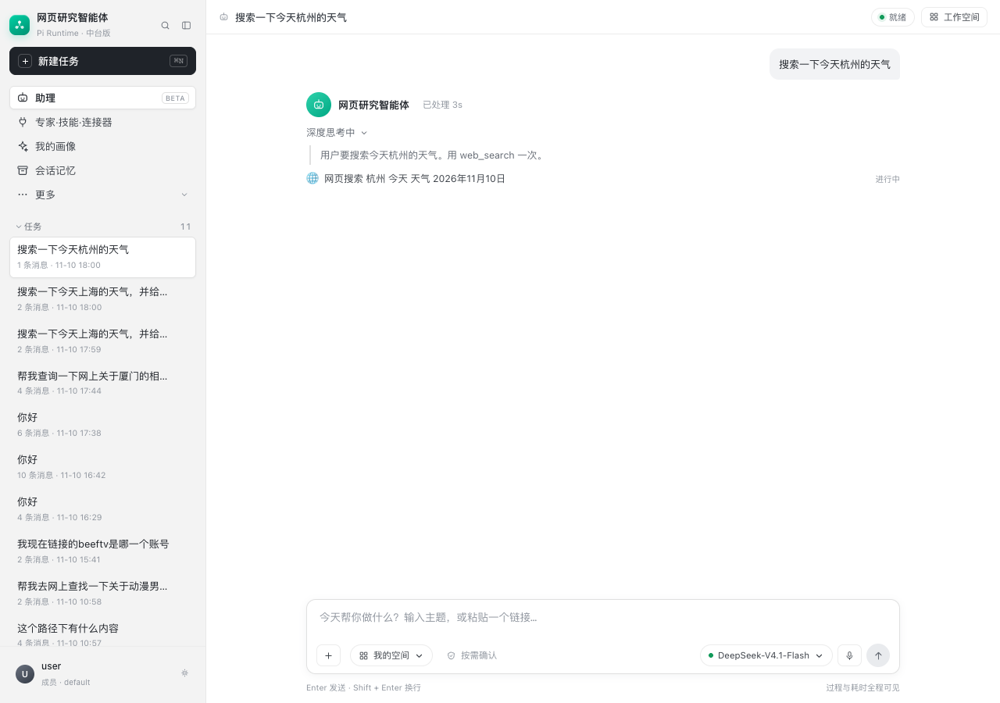

# 让聊天显示「思考时间 + 思考过程」

## 1. WorkBuddy 怎么做的（REA 证据）

REA Evidence：

```text
ev_11eca5809c23d8ec8442a47c30e40af6764abdd06d2659b2b792fe19b8f5e51a
```

目标文件：

```text
resources/extensions/im-channels/ui/assets/im-cloud-assistant-host-NLicxl1D.js
```

从扩展 bundle 里能直接看到这些文案与组件：

```text
reasoning.title          = 深度思考
reasoning.streamingTitle = 深度思考中
streamingDuration.label  = 已处理 {duration}
creditEstimate.prefix    = 预计消耗
fold.process             = 过程消息
```

关键实现不是“把隐藏 CoT 打印出来”，而是**内容协议 + 折叠块 + 状态行**：

1. 消息内容里有一种 `reasoning` 类型，转换器生成：

   ```text
   reasoning
     └─ collapse (title=深度思考, streaming)
          └─ text (theme=reasoning)
   ```

2. `TurnStatusLine` 用 `processingStartedAt` + 每秒 tick 渲染
   `已处理 {duration}`；
3. `CreditEstimate` 用历史相似任务给出 `min ~ max` 的预计消耗；
4. 工具调用/搜索结果进入 `fold.process` 折叠过程区；
5. 流式时 `expand/streaming` 为真，结束后变回“深度思考”。

所以它展示的是**模型真正返回的 reasoning 内容 + 工具步骤 + 计时/消耗**，
而不是伪造一段“思考中”。

## 2. 本项目实现

### 2.1 Pi 侧接收 reasoning

原 Pi Node 桥接只转发 `text_delta`，`thinking_delta` 被 `default` 丢掉。

现在：

```text
pi-ai thinking_delta
  → pi-runtime main.ts 发 kind=thinking_delta
  → Python _handle_event
  → reasoning_delta 事件
  → session_turn_events
  → SSE
```

同时把 `buildModel.reasoning` 保持关闭（只有网关实际返回
`reasoning_content` 时才会产生事件），不强行开启模型的 reasoning 参数。

### 2.2 事件类型

会话 turn 的 SSE 现在会推送：

```text
started          开局时间，前端启动计时
reasoning_delta  深度思考增量
tool_call        工具调用（如 web_search + query）
answer_delta     最终答复增量
done             终态
```

`started_at` 也写入事件，前端切换/重连后能继续算时间。

### 2.3 前端渲染

每个聊天 turn 上方增加一个过程卡：

```text
[头像] 网页研究智能体   已处理 7s
深度思考中 / 深度思考  ⌄
  │ 用户要搜索今天上海的天气……
  │ 先检查工作目录？不必要，直接搜索。
  🌐 网页搜索 上海 今天 天气 2026年11月10日   完成
```

- 计时每秒更新；
- `reasoning_delta` 追加到折叠体；
- `tool_call` 生成一行过程；
- 收到 `answer_delta` 后开始正文，过程卡保留；
- `done` 后停止计时，标题从“深度思考中”变为“深度思考”。



## 3. 实测

一次“搜索上海天气”的 turn：

```text
started            id=750
reasoning_delta    id=751..763  13 条
tool_call          id=764       web_search
answer_delta       id=765..882  118 条
done               status=succeeded
```

前端看到：

```text
已处理 7s
深度思考：用户要搜索今天上海的天气……先检查工作目录？不必要。直接搜索。
🌐 网页搜索 上海 今天 天气 2026年11月10日   完成
```

## 4. 边界

- 只有模型/网关真的返回 `reasoning_content` 时才有思考正文；
- 没有 reasoning 时仍显示“处理过程”+ 工具步骤 + 计时，不伪造思考；
- `预计消耗` 还没接：需要历史任务成本统计；当前先显示实际耗时；
- 工具结果事件目前只到 `tool_call`，UI 在正文开始时把步骤标记完成；
- 思考正文是模型输出，不是宿主秘密 CoT。
