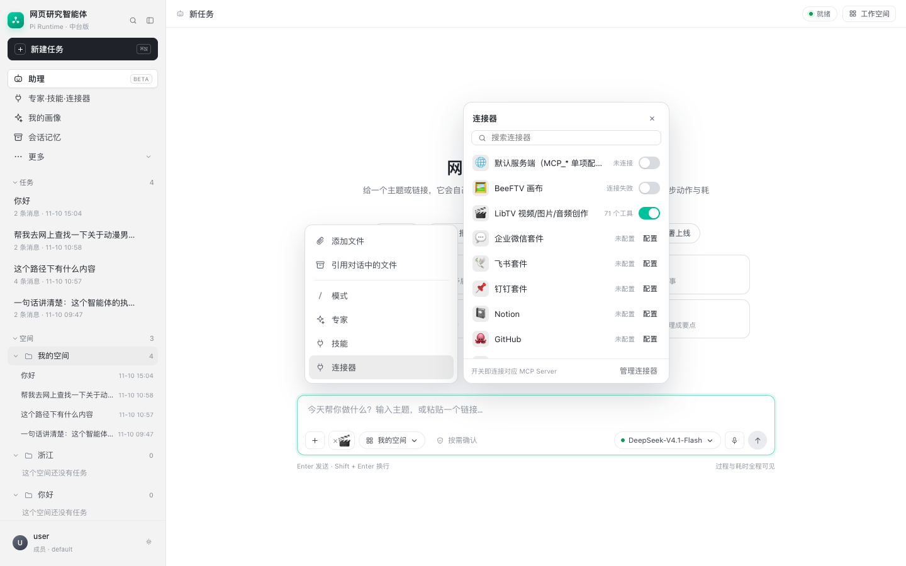

# 连接器悬停面板与输入框连接器标签

## 1. WorkBuddy 的交互

输入框左侧的「＋」菜单里有「连接器」。鼠标停在「连接器」上时：

- 不点击，右侧自动展开连接器面板；
- 「＋」菜单保持展开，面板贴在菜单右侧；
- 面板里可以搜索、开关连接器；
- 已经连接的连接器会以一个小标签出现在输入框里（X + 图标）；
- 点标签上的 X 移除；再次打开连接器面板可以重新连接。

背后是“悬停意图”设计：

- 鼠标进入菜单项后延迟约 150–250ms 才展开，避免划过时闪一下；
- 展开后，只要鼠标还在菜单或面板里就保持；
- 离开两个区域后再延迟关闭；
- 点击菜单项则打开“常驻”面板，直到点外部或 Escape。

标签的意义是：这条对话会带上这些连接器的工具能力。WorkBuddy 通常把它作为当前对话/任务的上下文状态，而不是全局账号状态。

## 2. 本项目实现

### 2.1 悬停自动展开

- `#plusMenu [data-act="connector"]` 监听 `mouseenter`，160ms 后打开 `#connectorPop`；
- 面板用 fixed 定位贴在菜单右侧，菜单保持展开；
- 鼠标进入面板会取消关闭计时；
- 离开菜单和面板 300ms 后自动关闭；
- 点击菜单项仍可打开常驻面板。

### 2.2 连接器标签

- 输入框新增 `#connectorChips`；
- 从 `/api/connectors` 读取 `enabled=true` 的连接器；
- 每个启用的连接器显示为「× + 图标」的小标签；
- 开关连接器成功后立即刷新标签；
- 点标签即断开该连接器（会同步更新连接器面板）；
- 图标按 id/name 映射，未识别的用通用链接图标。

### 2.3 删除两个无用入口

按需求移除了输入框里的：

- 上传附件按钮（回形针）；
- `/` 工具与指令按钮。

现在输入框左侧只保留「＋」、连接器标签、工作空间、权限确认。
「＋ → 添加文件」仍保留，但当前没有上传接口，点击会提示直接粘贴链接。

## 3. 与 WorkBuddy 的差异

- WorkBuddy 的连接器选择更偏“当前对话上下文”；本项目 `/api/connectors` 目前是**账号级**开关，标签显示该账号已启用的连接器；
- 点标签 X 在本项目会断开连接器（账号级），不是只从当前消息移除；
- 未配置的远程连接器显示「配置」，不会伪造连接成功。

如果以后要做会话级连接器，需要在会话记录里增加 `connector_ids`，发送消息时随上下文传给 Pi。
