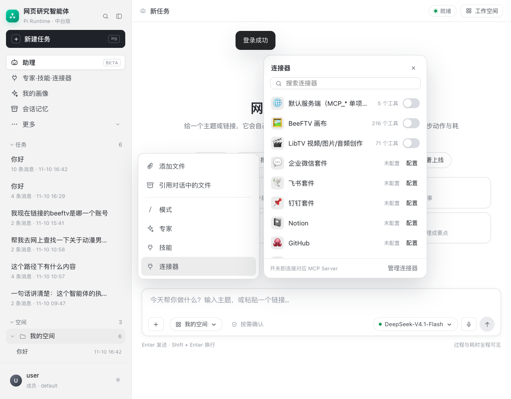
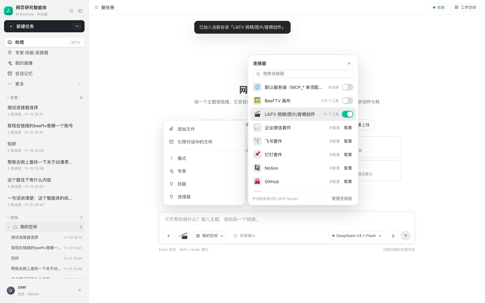

# 连接器相邻面板与输入框连接器标签

## 1. WorkBuddy 的交互

输入框左侧的「＋」菜单里有「连接器」。鼠标停在「连接器」上时：

- 不点击，右侧自动展开连接器面板；
- 「＋」菜单保持展开，面板贴在菜单右侧；
- 面板里可以搜索、开关连接器；
- 已经连接的连接器会以一个小标签出现在输入框里（X + 图标）；
- 点标签上的 X 移除；再次打开连接器面板可以重新连接。

背后是“悬停意图”设计：

- 鼠标进入菜单项后延迟约 150–250ms 才展开，避免划过时闪一下；
- 展开后，只要鼠标还在菜单或面板里就保持；
- 离开两个区域后再延迟关闭；
- 点击菜单项则打开“常驻”面板，直到点外部或 Escape。

标签的意义是：这条对话会带上这些连接器的工具能力。WorkBuddy 通常把它作为当前对话/任务的上下文状态，而不是全局账号状态。

## 2. 本项目实现

### 2.1 相邻面板（悬停/点击都保持 + 菜单）

按 WorkBuddy 的形态：

- 鼠标停在「连接器」上，160ms 后打开 `#connectorPop`；
- 「＋」菜单保持展开，面板贴在菜单右侧，底部对齐；
- 点击「连接器」也保持同样的“菜单 + 相邻面板”，不会关掉菜单；
- 面板是浮动卡片，不占满右侧，也不在页面最左边单独弹窗；
- 点外部、Escape、X 或再次点「＋」关闭；
- 输入框连接器标签和会话选择逻辑保持不变。

### 2.2 连接器标签（按会话选择）

- 输入框新增 `#connectorChips`；
- 选择状态按**当前会话**保存：
  `wb.connector.selection.v1.<user_id>`，结构是 `{sessionId: [connectorId]}`；
- 新任务默认不选连接器；打开旧任务时恢复该会话的选择；
- 连接器面板的开关现在表示“是否加入当前会话”：
  - 加入时如果连接器还没连过，会先调用 `/connect` 建立 MCP 会话；
  - 已连接但未选中的连接器，开关是关的，但元信息仍显示工具数；
  - 关闭开关只从当前会话移除，不断开账号级连接；
- 点标签上的 X 也只从当前会话移除；
- 发送消息时 body 带 `connector_ids`，服务端写入
  `session_turns.connector_ids_json`，供后续工具注入/审计。

### 2.3 删除两个无用入口

按需求移除了输入框里的：

- 上传附件按钮（回形针）；
- `/` 工具与指令按钮。

现在输入框左侧只保留「＋」、连接器标签、工作空间、权限确认。
「＋ → 添加文件」仍保留，但当前没有上传接口，点击会提示直接粘贴链接。

## 3. 与 WorkBuddy 的差异

- 会话级选择、标签、请求 payload 已对齐；
- `connector_ids` 已落库，业务 run 执行时按会话选择过滤 MCP 工具：
  显式空集合 = 不注入任何 MCP 工具，`NULL` = 兼容旧会话（全部）；
- 点 X / 关闭开关只移除会话选择，不主动打掉账号级 MCP 连接；
- 未配置的远程连接器显示「配置」，不会伪造连接成功；
- OAuth/设备码授权尚未接入，当前仍以 MCP token/stdio 配置为主。
