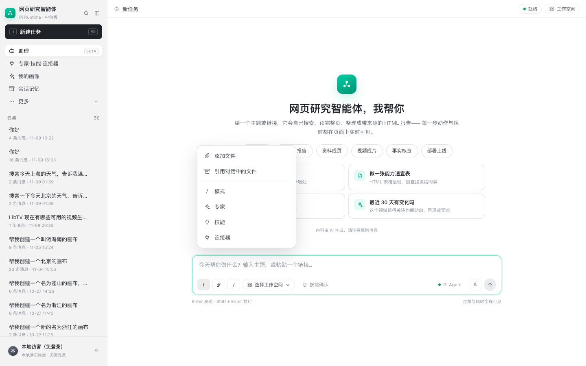
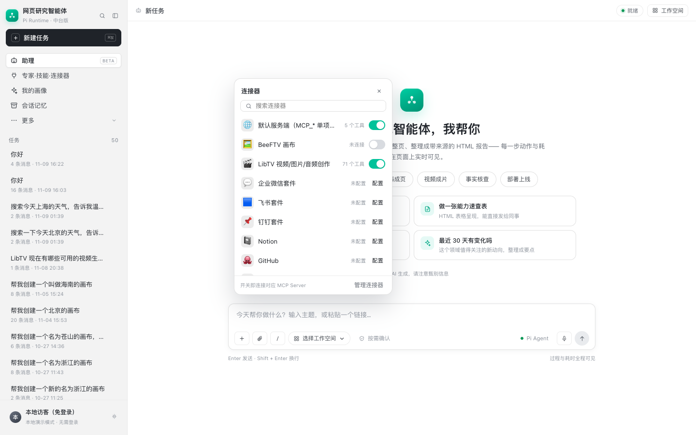
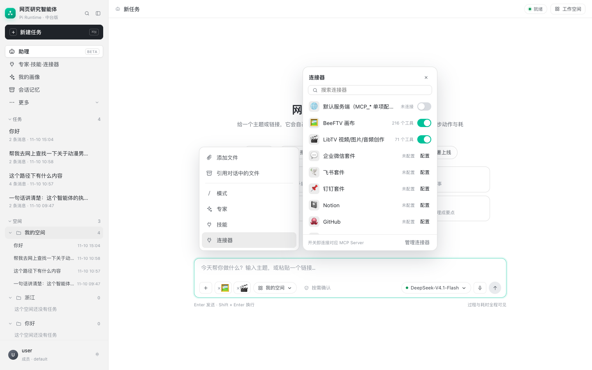

# 连接器（MCP Server）设计与实现

> 目标：复刻 WorkBuddy 输入框「+ → 连接器」的交互：面板里一排 MCP Server，**打开开关就连接对应的 MCP Server**，关闭就断开。

## 1. WorkBuddy 这块怎么设计

从截图看，输入框左侧的「+」是一个统一入口：

```
+ ── 添加文件
     引用对话中的文件
     ─────────────
     模式   >
     专家   >
     技能   >
     连接器 >
```

点「连接器」弹出一个面板：

```
搜索连接器
GitHub          [开关 ON]     已连接
LibTV           [开关 OFF]    已配置未连接
通达信          [连接]        需要授权/配置
腾讯自选股      [连接]
QQ邮箱          [连接]
ima             [连接]
乐享知识库      [连接]
腾讯文档        [连接]
...
管理连接器
```

三种状态对应三种行为：

| UI | 含义 | 点击 |
| --- | --- | --- |
| 开关 ON | 已连接，工具可被 agent 使用 | 关闭 → 断开 |
| 开关 OFF | 已配置，未连接 | 打开 → 建立 MCP 会话、发现工具 |
| 「连接」链接 | 未配置/未授权 | 进入 OAuth / API Key / 账号绑定 |
| 「管理连接器」 | 完整市场/设置页 | 跳到连接器管理 |

原理：一个连接器 = 一个 **MCP Server 配置**（transport + url/command + 凭证）+ 连接状态 + 工具清单。开关触发连接/授权，后端保存用户级绑定；agent 在工具清单里看到这些工具。





## 2. 本项目实现

### 2.1 前端

- 输入框左侧新增 `+` 按钮（`#plusBtn`）；
- 菜单 `#plusMenu`：添加文件 / 引用文件 / 模式 / 专家 / 技能 / 连接器；
- 连接器面板 `#connectorPop`：搜索、列表、开关、管理连接器；
- 打开开关调用 `POST /api/connectors/{id}/connect`，关闭调用 `disconnect`；
- 未配置的连接器显示「配置」，提示去 `.env` 的 `MCP_SERVERS` 添加；
- 「管理连接器」跳到技能中心的连接器 tab。

### 2.2 后端

| 方法 | 路径 | 作用 |
| --- | --- | --- |
| GET | `/api/connectors` | 已配置的 MCP Server + 目录里未配置的连接器 |
| POST | `/api/connectors/{id}/connect` | 真实建立 MCP 会话，`list_tools()`，记录工具数 |
| POST | `/api/connectors/{id}/disconnect` | 关闭开关（保留配置） |
| GET | `/api/connectors/{id}/tools` | 最近一次连接发现的工具 |

数据源：

- MCP Server 配置：`.env` 的 `MCP_SERVERS`，解析在 `integrations/mcp_servers.py`；
- 连接：`integrations/mcp_adapter.list_server_tools(server)`，支持 `streamable_http` / `sse` / `stdio`；
- 状态：`profile/skillhub/connectors/<tenant>__<user>.json`；
- 未配置连接器：`skillhub/catalog.py` 的 `CONNECTORS`。

## 3. 当前本机可用的连接器

| id | 名称 | transport | 实测 |
| --- | --- | --- | --- |
| `publishing` | 默认服务端（MCP_*） | streamable_http | ✅ 5 个工具 |
| `libtv` | LibTV 视频/图片/音频创作 | stdio | ✅ 71 个工具 |
| `beeftv` | BeeFTV 画布 | stdio | ⚠️ 需要已验证的登录来源主体 |

`publishing` 和 `libtv` 打开开关就会真实连上并发现工具；`beeftv` 在未登录/无主体上下文时会明确报错，不会假装成功。

## 4. 怎么新增一个连接器

在 `.env` 的 `MCP_SERVERS` 里加一条，然后重启服务：

```json
[
  {
    "id": "github",
    "title": "GitHub",
    "transport": "streamable_http",
    "url": "https://your-github-mcp.example.com/mcp",
    "token": "..."
  },
  {
    "id": "my-stdio",
    "title": "本地工具",
    "transport": "stdio",
    "stdio_command": "node",
    "stdio_args": ["/path/to/server.mjs"]
  }
]
```

重启后打开「+ → 连接器」，新条目会出现，开关可用。未配置的条目会显示「配置」。

## 4.1 需要登录主体的 stdio MCP（BeeFTV）

BeeFTV 的 MCP 配置里带：

```json
{
  "id": "beeftv",
  "transport": "stdio",
  "forward_subject": true,
  "stdio_env": {"BEEFTV_BASE_URL": "http://127.0.0.1:8004"}
}
```

`forward_subject` 表示 MCP 子进程需要知道“当前是哪个登录用户”。原来的实现只在 **agent run** 里取 `runs.platform_subject`；连接器开关是在 run 之外做工具发现，所以会报：

```text
RuntimeError: MCP 服务要求已验证的登录来源主体
```

修复分两步：

1. 工具发现接受一个已验证的 `subject`：
   `list_server_tools(server, subject=principal.subject)`；
   `connect_session(..., subject=...)` 把它写进 stdio 的
   `MCP_CALLER_SUBJECT`；
2. BeeFTV 的 MCP 还要求 `MCP_BEARER_TOKEN`（hub MCP token）。
   在 `MCP_SERVERS` 的 beeftv 条目加：

```json
{
  "id": "beeftv",
  "token": "从 .local/secrets/hub-mcp-token 读取",
  "stdio_env": {"BEEFTV_BASE_URL": "http://127.0.0.1:8004"}
}
```

BeeFTV 服务端本身也要用同一个 token 文件启动：

```text
BEEFTV_HUB_MCP_TOKEN_FILE=/Users/.../BeefTV/.local/secrets/hub-mcp-token
```

本项目通过 `run.py` 启动 BeeFTV 时已经会自动读取这个文件。

修复后 BeeFTV 连接返回 216 个工具，输入框出现 🖼 标签：



## 5. 边界

- 开关会**真实建立 MCP 会话并调用 `list_tools()`**，这是“连接”的证据；
- 当前“关闭”只更新本用户的连接状态，不强制杀掉已池化的 stdio 进程；
- agent 每次对话实际能用哪些工具，仍由现有工具策略/绑定决定；把「已启用连接器」注入每轮工具清单是下一步；
- 未配置的连接器需要先在 `MCP_SERVERS` 加配置，不能凭空连接；
- WorkBuddy 的「连接」还包含 OAuth/账号授权流程，本项目暂未实现 OAuth，只用 token/stdio env。
