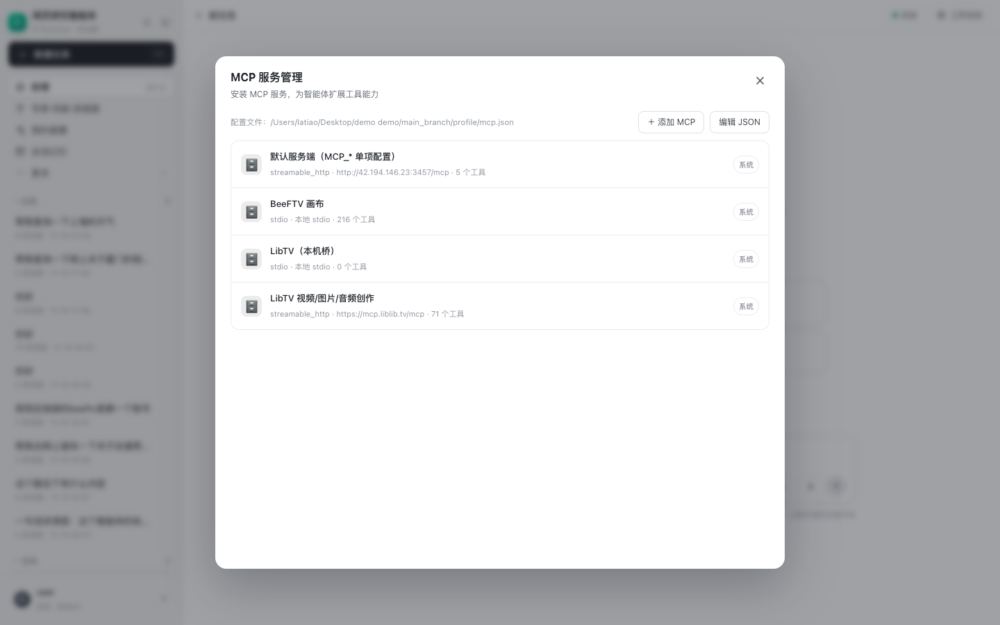

# WorkBuddy 的「添加 MCP Server」是怎么实现的，以及中台版

## 1. REA 证据

```text
Evidence: ev_33a10e624f13a5eaf41705c4cb9397fdd82db7d6b47d606a8b6bbbcc15a9b2f6
Target:   WorkBuddy.app/Contents/Resources/app.asar
Source:   main/server.js
```

静态分析确认，WorkBuddy 不是把 MCP 配置存在数据库，而是维护一份与
Claude Desktop 同形态的本地 JSON：

```text
~/ .workbuddy / mcp.json
{
  "mcpServers": {
    "name": {
      "type": "streamable-http",
      "url": "https://.../mcp",
      "headers": {},
      "timeout": 120000
    }
  }
}
```

### 1.1 文件层：`UserMcpFile`

`main/server.js` 里的 `UserMcpFile`：

- `filePath = getConfigDir()/mcp.json`；
- 文件不存在时返回默认 `{"mcpServers":{}}`；
- `prepareContent()` 校验：
  - 根节点必须是对象；
  - `mcpServers` 必须是对象；
  - 每个 server 必须是对象，不允许嵌套 `mcpServers`；
- `upsert()`：
  - `stdio` 必须有 `command`；
  - 远程必须有合法 `url`；
  - 类型只接受 `stdio` / `streamable-http` / `sse`；
  - 支持 `args/env/cwd/headers/timeout/disabled`；
  - 重名会抛 `McpNameTakenError`；
- `setDisabled()` 写 `disabled`，`remove()` 删除条目；
- 文件原子写入，发生错误时保留旧内容。

### 1.2 通道层

`registerMcpHandlers` 暴露：

```text
mcpList
mcpSave
mcpRemove
mcpConnect
mcpBeginAuthorization
mcpGetConfigContent / mcpSaveConfigContent（已退役，映射到 mcp:list/mcp:save）
mcpImportServer
```

旧通道被明确标记为 retired，并提示替代调用，不做静默兼容。

### 1.3 信任层

`McpTrustStore` 对 stdio 的 command/args/env/cwd 和远程 origin 做指纹，
批准记录在 `mcp-approvals.json`。这解决的是“用户改一条命令就变成任意执行”
的问题，而不是单纯 UI 校验。

### 1.4 UI

MCP 服务管理弹窗：

- 显示配置文件绝对路径；
- 列表展示已安装 server；
- “添加 MCP”进入 JSON 编辑；
- 保存时写回 `mcp.json`；
- 关闭/取消不改文件。

## 2. 中台实现

### 2.1 同形态配置文件

```text
profile/mcp.json
{
  "mcpServers": {
    "my-mcp": {
      "type": "streamable-http",
      "url": "https://example.com/mcp",
      "headers": {"X-Api-Key": "..."}
    }
  }
}
```

可用 `MCP_USER_CONFIG_FILE` 覆盖路径。

### 2.2 安全边界

中台只接受 **HTTP/SSE 远程 MCP**：

- `stdio` 配置在保存时直接 400；
- 本地进程继续由运维通过 `MCP_SERVERS` 配置；
- 服务名限制为 `字母数字 _ . -`，且不能含 `__`（工具路由分隔符）；
- 文件写入使用 `0600` 和原子替换。

这是和 WorkBuddy 的有意差异：WorkBuddy 是本地单用户应用，可以为 stdio 做
信任审批；中台是多用户 Web 服务，不能把浏览器里的一条 JSON 直接变成
`command` 执行。

### 2.3 注册表合并

`mcp_servers.servers()` 每次读取：

1. 系统 `MCP_SERVERS` / `MCP_SERVERS_FILE`；
2. 用户 `profile/mcp.json` 的远程项；
3. **系统 id 优先**，用户不能同名覆盖运维配置。

新增的 server 会自动出现在：

- `/api/connectors`；
- 输入框连接器面板；
- 会话级连接器选择；
- Pi 工具目录（选中后注入）。

### 2.4 API

```text
GET  /api/mcp/config     读取路径和原始 JSON
PUT  /api/mcp/config     校验并保存
GET  /api/mcp/servers    系统 + 自定义合并列表
```

### 2.5 UI

连接器面板底部「管理连接器」打开「MCP 服务管理」：

- 显示配置文件路径；
- 列表显示系统/自定义、传输方式、URL、工具数；
- 「添加 MCP」/「编辑 JSON」进入编辑器；
- 保存后刷新连接器列表；
- 取消/关闭不落盘。



## 3. LibTV

中台已经有两个 LibTV 条目：

```text
libtv-local  本机 stdio 桥
libtv        https://mcp.liblib.tv/mcp   streamable-http
```

`/api/connectors` 实测 `libtv` 返回 **71 个工具**，连接器面板里可以直接勾选。
官方远端 `https://mcp.liblib.tv/mcp` 无凭据直接请求会 401，但当前 `libtv`
配置带鉴权，已能正常发现 71 个工具。

## 4. 实测

```text
PUT custom demo-remote
→ /api/mcp/servers 出现 demo-remote
→ /api/connectors 出现 demo-remote
→ stdio 配置返回 400
→ 恢复空配置
```

UI 实测：

```text
MCP 服务管理
默认服务端（MCP_* 单项配置） 5 个工具
BeeFTV 画布 216 个工具
LibTV（本机桥） 0 个工具
LibTV 视频/图片/音频创作 71 个工具
```

## 5. 边界

- 配置文件是**实例级**的，不是每个中台用户一份；多租户隔离需要再加
  `owner_user_id` 和权限校验；
- 自定义 MCP 目前只支持远程 HTTP/SSE；
- 编辑器以原文展示 headers，里面可能含密钥；接口已要求登录，文件权限 0600；
- 保存后不会自动连接，需要到连接器面板打开开关；
- WorkBuddy 的 `McpTrustStore` 本地命令信任机制没有迁移，因为中台不接受 stdio。
