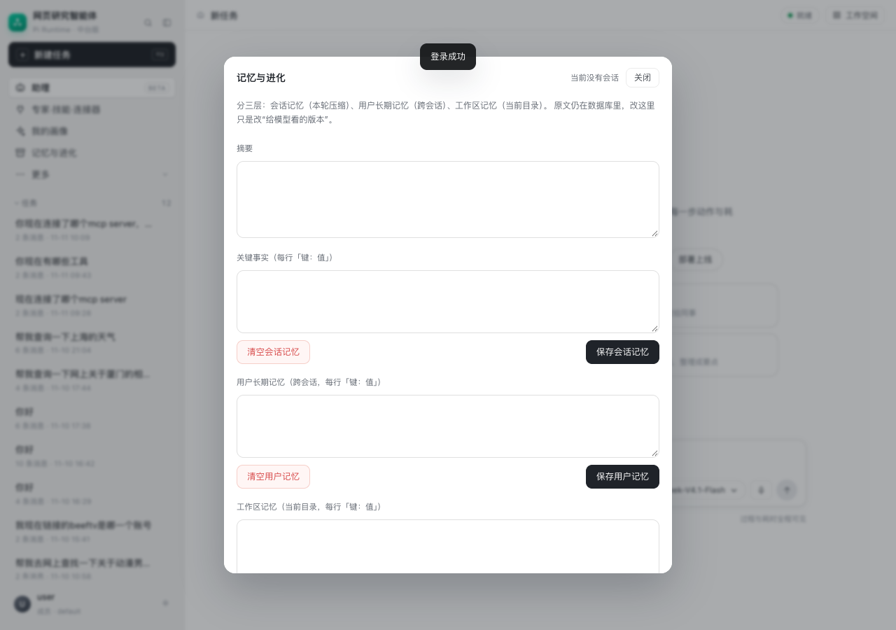

# WorkBuddy 记忆系统分析与中台迁移

## 1. REA 证据

```text
Evidence: ev_33a10e624f13a5eaf41705c4cb9397fdd82db7d6b47d606a8b6bbbcc15a9b2f6
Target:   WorkBuddy.app/Contents/Resources/app.asar
Source:   main/server.js
```

同一版本里还提取了：

```text
renderer/assets/MemorySettingsPanel-DwWN62Eb.js
prompt-common/fragments/workbuddy-memory-system.md
prompt-common/fragments/cloud-memory-platform-system.md
prompt-common/fragments/workspace-project-memory.md
```

## 2. WorkBuddy 的三层记忆

### Layer 1：云端长期记忆

- 服务端按天生成用户画像 `memoryBlock`；
- 会话开始时注入 `<memory>...</memory>`；
- 本地缓存到配置目录的 `memory/`，有版本号和更新时间；
- 有 `MemoryRecall` / `MemoryUpdate` 工具；
- `conversation_search` 搜索历史会话（和当前会话隔离，查询必须自包含）。

### Layer 2：用户级本地记忆

```text
<用户目录>/MEMORY.md
```

- 跨项目；
- 用户明确要求长期记住时写入；
- 每次会话最多 3,000–4,000 字符；
- 适合精确规则，例如“始终用中文回复”。

### Layer 3：工作区记忆

```text
<项目>/.workbuddy/memory/
  YYYY-MM-DD.md   每日 append-only 日志
  MEMORY.md       项目长期约定
```

- 只对当前项目生效；
- 完成实质工作后追加日志；
- 超过 30 天把日志蒸馏进 MEMORY.md；
- 不保存秘密、临时搜索结果、工具报错。

### 设置与并发

`MemorySettingsPanel` 提供：

```text
云端记忆开关
本地记忆开关
查看/编辑记忆
导入其他 AI 的记忆
重置记忆
```

服务端保存时用 polling lease + mutation 锁，避免多窗口同时改写。
后端 API 包括：

```text
/api/memory/profile
/api/memory/global/settings
/api/memory/global/summary
```

## 3. 中台实现

### 3.1 三层映射

| WorkBuddy | 中台 |
|---|---|
| 会话压缩 | 现有 `session_memory` |
| 用户长期记忆 | `memories(scope_type='user', scope_id=user_id)` |
| 工作区记忆 | `memories(scope_type='workspace', scope_id=workspace_dir)` |

复用现有 `memories` / `memory_tombstones` 版本化事实表。

### 3.2 聊天 turn 的压缩与注入

聊天 turn 现在和任务 run 一样先压缩：

```text
_run_pi_chat
  → memory_module.compact(session_id)
  → 得到 summary / facts / upto
  → chat_history 只取 id > upto 的消息（最多最近 6 条原文）
  → 系统提示注入 <session_memory>
```

阈值：

```text
未摘要消息 > 12 条
或估算 > 3000 tokens
```

压缩时保留最近 6 条原文，把更早消息和旧摘要合成新的
`summary + facts`，写回 `session_memory`。

### 3.3 提示注入

`_run_pi_chat` 在系统提示里加入：

```text
<memory>
用户长期记忆：
- 回复语言：中文
当前工作区记忆：
- 项目：网页研究智能体
</memory>
```

并明确：记忆是背景，当前用户输入和当前事实优先。

短期压缩块形如：

```text
<session_memory>
这是本会话更早对话的摘要；最近几轮原文仍然保留。
摘要：用户正在规划鼓浪屿旅行……
关键事实：
- 目的地：鼓浪屿
</session_memory>
```

### 3.4 自动提取

每轮闲聊结束后跑一次结构化提取（`MEMORY_EXTRACT_MODE=always`，默认）。

触发**不再看关键词表**：`我来自浙江台州` 当年就不在表里，那一轮整段被跳过，
而模型的回答里已经写着"已记录"——画像和界面从此对不上。现在值不值得记由模型
判断，写进画像的部分仍由身份键白名单 + 12 条上限卡住（见 3.6）。

- 一句话寒暄（去掉空白后不足 4 字，如"好的""谢谢"）直接跳过；
- 想省一次调用可设 `MEMORY_EXTRACT_MODE=cue`（回到关键词表），`off` 全关；
- 只保存：身份 / 长期偏好 / 固定规则 / 长期项目事实；过滤一次性请求、天气、
  工具报错、搜索结果、密码·Token。

**成本**（实测 `deepseek-v4-1-flash`，2026-11-13）：一次抽取 input 约 545–551
token、output 约 40–71 token，合计约 580–620 token。构成：抽取提示词 ~200、
工具 schema ~100、本轮对话 ~20，其余是 provider 的对话模板开销。无关闲聊也会
白跑一次（约 620 token）——这就是短消息要跳过、`cue` 模式还留着的原因。

**回执**：抽取在 turn 结束**之前**完成（原先 `create_task` 后台跑，但 SSE 在
done 之后就关了，后台再写事件没人收）。画像真有变化时写一条 `memory_learned`
事件，界面「处理过程」里显示"已记住：籍贯=浙江台州"。这条才代表真的写进去了，
模型自己说"已记录"不作数。

回执成对出现（2026-11-16 补）：抽取**失败/超时**写 `memory_extract_failed`，
界面显示"本轮没记住：记忆抽取超时（下一轮会再试）"。此前 `except Exception:
return ExtractResult()` 把失败全吞进 debug 日志，界面上一个字都没有——模型的
回答里已经写着"已记录"，用户打开画像才发现没变，只能怀疑整个记忆是假的。
抽到空结果**不算失败**（这轮本来就没有值得记的），否则每句寒暄都弹一条警告。

### 3.5 管理界面

「记忆与进化」分三块：

- 会话记忆（摘要 + 关键事实）；
- 用户长期记忆（跨会话）；
- 工作区记忆（当前目录）。

可编辑、保存、清空。清空用户/工作区记忆会写墓碑，防止自动提取马上又写回来。

API：

```text
GET    /api/memory
PUT    /api/memory   {scope: user|workspace, facts: "键：值\n..."}
DELETE /api/memory?scope=user|workspace
```

### 3.6 画像与记忆的边界（2026-11-12 修补）

这两个入口以前是"各写各的"：画像只在任务规划链路注入（`agent/nodes.py`、
`capabilities/answers.py`），聊天那一路完全没拼过；长期记忆和画像又都能存偏好，
同名键会给模型两个值。现在统一成一条规则。

| | 我的画像 | 记忆与进化 |
|---|---|---|
| 回答 | 你是谁（身份、称呼、语言、风格） | 聊过什么、这个项目什么情况 |
| 载体 | `profile/<user>.md`（原子写 + 版本 + `.bak`） | `memories` 表（版本化 + 墓碑） |
| 注入 | 聊天与任务都拼进 system prompt | 聊天拼 `<session_memory>` / `<memory>` |
| 冲突 | **画像优先**：`<memory>` 里同键跳过 | 同键让位给画像 |
| 清理 | 删文件、留 `.bak` | 写墓碑，防止自动提取回流 |

写入口径：

- 规划任务时模型顺带给出的画像更新 → `profile.merge()`，只播报真正变化的条目；
- 闲聊每轮自动提取（3.4）→ 提取进 user scope，画像同步分三种情况：
  - 这个键画像里**已经**有 → 同步回写，保证"最近一次改口"生效；
  - 画像里没有、但属于**身份型**白名单（`memory.is_profile_key`：称呼/姓名/城市/
    职业/公司/语言/风格/偏好…）→ 允许新增，且总量卡在 `PROFILE_MAX_KEYS`（12 条）；
  - 项目型的键（目标、已否决、报错、待办…）→ 只进记忆，不进档案。

改动点：

```text
core/profile.py       _path/load/block/with_profile/version/save/merge 支持显式 user
core/memory.py        render_long_term(override_keys=...)、提取时回写画像；
                      身份型新键放行 + PROFILE_MAX_KEYS 上限（2026-11-13）
api/hub_messages.py   聊天 system prompt 拼画像，按 owner_user_id 读
api/web/index.html    画像面板说明补上"画像优先"
```

验证：

```text
tests/test_chat_profile_injection.py        画像进了聊天提示、同键不重复
tests/test_memory_extract_profile_sync.py   改口回写、身份键自举空画像、项目键不撑大档案、上限封顶、
                                            失败带回原因而不是静默
tests/test_memory_receipt_events.py         记住有回执、没记住也有回执、空结果不吵
tests/test_profile_scoping.py               显式 user 读自己的文件
tests/test_profile_editable.py              编辑框去掉文件头、时间本地化、往返保存不多出伪事实
```

2026-11-13 修补：以前画像的**自动新增**只发生在任务规划，于是从没填过的画像
永远长不出第一条——面板一直「尚未建立」，聊多少轮都还是空（`plans` 表没记录就
等于这条路一次没走过）。现在闲聊抽取放行身份型新键并卡住总量，
档案保持"我是谁"的定位，不变成第二份记忆。

同日第二轮：把触发从关键词表改成每轮都交给模型判断，并补了 `memory_learned`
回执。原因见 3.4——关键词表漏掉"我来自台州"，而回答里已经写了"已记录"，
用户打开画像发现只有上一次的内容。

2026-11-16 第三轮：补 `memory_extract_failed` 回执（3.4）。排查"我来自浙江台州"
为什么没写进画像时发现，那一轮（11-13 14:46）跑的还是关键词门控的旧代码——
第二轮修补落地于当天 15:23，晚于这次对话，抽取整轮被跳过，画像停在 v3。
这条链路本身没坏，坏的是"失败与跳过在界面上完全无声"，所以补了失败回执。

同日画像面板收口：编辑框只留事实，文件头那两行不再进界面——
`# User Profile` 让 git diff 认得出这是画像，`> Version: n` 是 `expected_version`
乐观锁的凭据，两者都对用户没意义；`> Last updated` 则换成本机时区的
「更新时间：2026-11-16 10:44」（原来那串 ISO 带微秒和 `+00:00`，得先做时区换算
才看得懂）。保存仍走 `parse()`，「更新时间」在 `_RESERVED_KEYS` 里被剔掉：
否则用户打开看一眼就点保存，档案里会多出一条伪事实。



## 4. 实测

会话摘要注入：

```text
PUT 会话记忆：目的地=鼓浪屿，出行时间=2026年11月
→ 下一轮问“根据会话摘要，我的目的地和出行时间是什么？”
→ 回答：目的地：鼓浪屿；出行时间：2026年11月
```

写入：

```text
回复语言：中文
风格：简洁直接
项目：网页研究智能体
约定：回答附来源
```

下一轮问“你还记得我的回复语言偏好和项目约定吗？”模型回答：

```text
回复语言：中文（风格简洁直接）
项目约定：回答要附来源；当前项目是「网页研究智能体」
```

自动提取：

```text
用户：记住：以后所有回答都用中文，并且先给结论。
→ 后台提取并写入 user scope
```

## 5. 与 WorkBuddy 的差距

- 没有服务端“每晚重新生成云端画像”的批处理；
- 没有 `conversation_search` 历史会话检索工具；
- 没有工作区每日日志文件，只保留工作区事实；
- 没有从 ChatGPT/Claude 导入记忆；
- 自动提取的**门控**已从关键词表改为默认每轮都跑（`MEMORY_EXTRACT_MODE=always`）：
  关键词永远漏（"我来自浙江台州"就不在表里，画像停在上一轮，而回答里已经写着"已记录"）；
  值不值得记交给模型判断，写画像的部分仍由身份键白名单 + 12 条上限卡住。
  想省一次小模型调用可切回 `cue`，彻底关闭用 `off`。

这些是后续可继续迁移的点。
