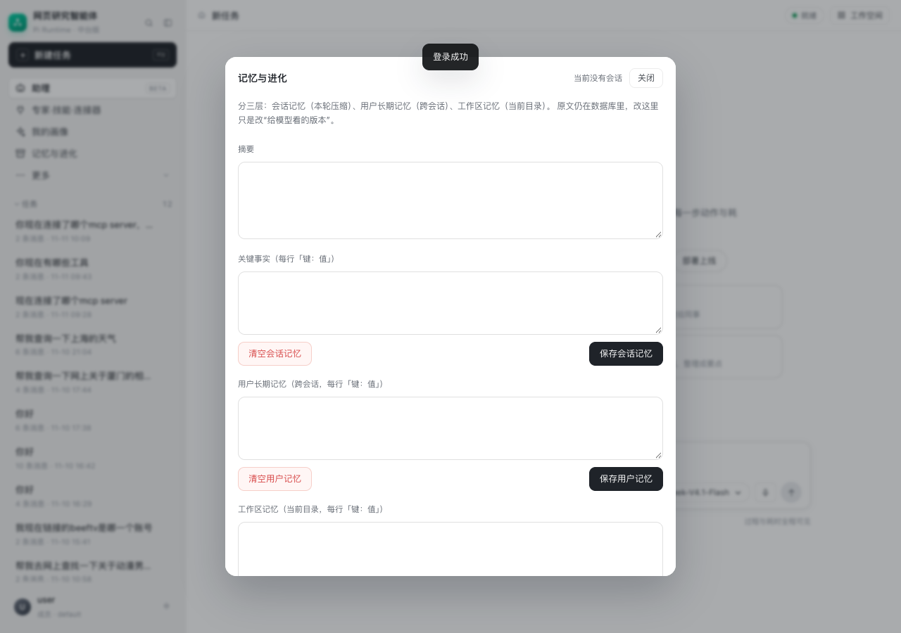

# WorkBuddy 记忆系统分析与中台迁移

## 1. REA 证据

```text
Evidence: ev_33a10e624f13a5eaf41705c4cb9397fdd82db7d6b47d606a8b6bbbcc15a9b2f6
Target:   WorkBuddy.app/Contents/Resources/app.asar
Source:   main/server.js
```

同一版本里还提取了：

```text
renderer/assets/MemorySettingsPanel-DwWN62Eb.js
prompt-common/fragments/workbuddy-memory-system.md
prompt-common/fragments/cloud-memory-platform-system.md
prompt-common/fragments/workspace-project-memory.md
```

## 2. WorkBuddy 的三层记忆

### Layer 1：云端长期记忆

- 服务端按天生成用户画像 `memoryBlock`；
- 会话开始时注入 `<memory>...</memory>`；
- 本地缓存到配置目录的 `memory/`，有版本号和更新时间；
- 有 `MemoryRecall` / `MemoryUpdate` 工具；
- `conversation_search` 搜索历史会话（和当前会话隔离，查询必须自包含）。

### Layer 2：用户级本地记忆

```text
<用户目录>/MEMORY.md
```

- 跨项目；
- 用户明确要求长期记住时写入；
- 每次会话最多 3,000–4,000 字符；
- 适合精确规则，例如“始终用中文回复”。

### Layer 3：工作区记忆

```text
<项目>/.workbuddy/memory/
  YYYY-MM-DD.md   每日 append-only 日志
  MEMORY.md       项目长期约定
```

- 只对当前项目生效；
- 完成实质工作后追加日志；
- 超过 30 天把日志蒸馏进 MEMORY.md；
- 不保存秘密、临时搜索结果、工具报错。

### 设置与并发

`MemorySettingsPanel` 提供：

```text
云端记忆开关
本地记忆开关
查看/编辑记忆
导入其他 AI 的记忆
重置记忆
```

服务端保存时用 polling lease + mutation 锁，避免多窗口同时改写。
后端 API 包括：

```text
/api/memory/profile
/api/memory/global/settings
/api/memory/global/summary
```

## 3. 中台实现

### 3.1 三层映射

| WorkBuddy | 中台 |
|---|---|
| 会话压缩 | 现有 `session_memory` |
| 用户长期记忆 | `memories(scope_type='user', scope_id=user_id)` |
| 工作区记忆 | `memories(scope_type='workspace', scope_id=workspace_dir)` |

复用现有 `memories` / `memory_tombstones` 版本化事实表。

### 3.2 聊天 turn 的压缩与注入

聊天 turn 现在和任务 run 一样先压缩：

```text
_run_pi_chat
  → memory_module.compact(session_id)
  → 得到 summary / facts / upto
  → chat_history 只取 id > upto 的消息（最多最近 6 条原文）
  → 系统提示注入 <session_memory>
```

阈值：

```text
未摘要消息 > 12 条
或估算 > 3000 tokens
```

压缩时保留最近 6 条原文，把更早消息和旧摘要合成新的
`summary + facts`，写回 `session_memory`。

### 3.3 提示注入

`_run_pi_chat` 在系统提示里加入：

```text
<memory>
用户长期记忆：
- 回复语言：中文
当前工作区记忆：
- 项目：网页研究智能体
</memory>
```

并明确：记忆是背景，当前用户输入和当前事实优先。

短期压缩块形如：

```text
<session_memory>
这是本会话更早对话的摘要；最近几轮原文仍然保留。
摘要：用户正在规划鼓浪屿旅行……
关键事实：
- 目的地：鼓浪屿
</session_memory>
```

### 3.4 自动提取

用户消息命中长期记忆线索时：

```text
记住 / 记一下 / 以后都 / 始终 / 总是 / 不要 / 偏好 / 习惯 / 我叫 ...
```

回答完成后后台调用一次结构化提取，只保存：

- 身份；
- 长期偏好；
- 固定规则；
- 长期项目事实。

过滤一次性请求、天气、工具报错、搜索结果、密码/Token。

### 3.5 管理界面

「记忆与进化」分三块：

- 会话记忆（摘要 + 关键事实）；
- 用户长期记忆（跨会话）；
- 工作区记忆（当前目录）。

可编辑、保存、清空。清空用户/工作区记忆会写墓碑，防止自动提取马上又写回来。

API：

```text
GET    /api/memory
PUT    /api/memory   {scope: user|workspace, facts: "键：值\n..."}
DELETE /api/memory?scope=user|workspace
```



## 4. 实测

会话摘要注入：

```text
PUT 会话记忆：目的地=鼓浪屿，出行时间=2026年11月
→ 下一轮问“根据会话摘要，我的目的地和出行时间是什么？”
→ 回答：目的地：鼓浪屿；出行时间：2026年11月
```

写入：

```text
回复语言：中文
风格：简洁直接
项目：网页研究智能体
约定：回答附来源
```

下一轮问“你还记得我的回复语言偏好和项目约定吗？”模型回答：

```text
回复语言：中文（风格简洁直接）
项目约定：回答要附来源；当前项目是「网页研究智能体」
```

自动提取：

```text
用户：记住：以后所有回答都用中文，并且先给结论。
→ 后台提取并写入 user scope
```

## 5. 与 WorkBuddy 的差距

- 没有服务端“每晚重新生成云端画像”的批处理；
- 没有 `conversation_search` 历史会话检索工具；
- 没有工作区每日日志文件，只保留工作区事实；
- 没有从 ChatGPT/Claude 导入记忆；
- 自动提取只在命中记忆线索时触发，不是每轮都做。

这些是后续可继续迁移的点。
