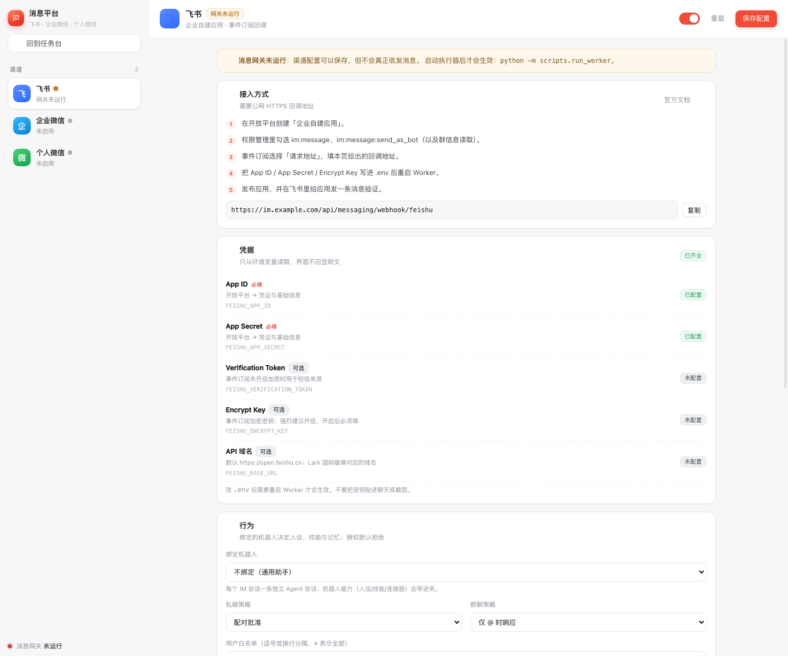

# 消息平台（IM 网关）：飞书 / 企业微信 / 个人微信

> 面向使用与实现：把「一个会长期存在的 Agent」接到 IM 里，而不是给每个平台写一套
> 机器人。左侧工具栏「消息平台」进入，`/api/ui/messaging`。

一句话：**API 进程收、数据库当中转、Worker 进程执行、Transport 只管协议**。渠道是
清单驱动的插件：加平台 = 加一份 `ChannelManifest` + 一个 `Transport`，控制面与页面
不用改。



## 1. 先看能力边界

| 渠道 | 接入方式 | 要公网 HTTPS | 单聊 | 群聊 | 卡片/流式 | 备注 |
| --- | --- | --- | --- | --- | --- | --- |
| 飞书 | 自建应用 + 事件订阅**回调** | 是 | ✅ | ✅ 仅 @ | ❌ / ❌ | 不走长连接：`lark-oapi` 要求 `websockets<16`，与 MCP 依赖冲突 |
| 企业微信 | 自建应用 + API 接收回调 | 是 | ✅ | ⚠️ 取决于应用能力 | ❌ / ❌ | 群机器人 webhook 只能发不能收 |
| 个人微信 | 腾讯 iLink Bot + 扫码 | 否 | ✅ | ❌ | 打字状态 ✅ | bot 身份，不是本人号；会话会过期 |

**明确不做**：个人微信 hook / 逆向协议（封号 + 合规风险）；公众号（需要认证服务号，
且被动回复 5 秒 / 客服消息 48 小时窗口，作为下一阶段单独评估）；跨网关互通。

### 1.1 个人微信必须知道的限制

iLink 是腾讯给 bot 的接口，不是"把本人微信变成机器人"：

- 身份是 `xxx@im.bot`，对方看到的是 bot，不是你的微信号；
- **普通微信群基本收不到事件**，所以能力声明里 `group=False`；
- 主动发消息要回显该会话最近的 `context_token`；没有新鲜 token 时只能等对方先说话；
- 会话会过期（`errcode=-14`）：状态置 `fatal`，必须重新扫码；网关**不会**自动重试风暴；
- iLink 没有公开文档，接口可能变；它默认关闭，且随时可以降级为"不可用"。

## 2. 它怎么跑起来

```
飞书/企微 ──POST──▶ /api/messaging/webhook/<channel>   (验签、解密、归一化)
                              │
                              ▼
                      im_inbox（入站队列，幂等）
                              │  Worker 每 3s 领取
                              ▼
                    MessagingGateway.tick()
                      ├─ authorize（默认拒绝；未知私聊发配对码）
                      ├─ 命令 /help /new /stop /who /bind /unbind
                      └─ ImBridge → 会话 turn → Pi 执行
                              │
                              ▼
                      im_outbox（出站队列，唯一 sent_key）
                              │  重试/退避
                              ▼
                    Transport.send() → 平台 API

个人微信 ──getupdates 长轮询──▶ Transport.on_inbound() ──▶ im_inbox（同上）
```

为什么用数据库队列而不是回调里直接跑 Agent：

1. 飞书要求 3 秒、企微要求 5 秒内响应，跑模型必然超时；
2. 平台重投同一条消息很常见，`im_inbox` + `im_processed` 双保险保证只执行一次；
3. Worker 可能多副本，但 **iLink 长轮询只能有一个消费者**：网关用 PostgreSQL
   advisory lock（`719284632`）选主，只有抢到锁的 Worker 启动渠道。

渠道**启用了但还没就绪**（启动中、凭据暂时不可用）时，入站消息留在 `im_inbox`
里等（最长 24 小时），不丢；渠道是禁用状态则直接丢弃并记审计事件。

### 2.1 与既有会话执行链的关系

没有为 IM 另造 Agent 调用。每个 IM 会话映射一条 `sessions.session_kind='im_chat'`
的会话（`hidden=1`，普通侧栏看不到），每个渠道可以绑定一个机器人（`bots`），于是
人设、技能、连接器、记忆、模型、审批策略全部复用 `addons.resolve()` 与
`session_turns`。`message_id` 直接当 `request_id`：平台重投 → `(session_id,
request_id)` 唯一键命中 → 不会跑第二遍。

### 2.2 谁在回话：三层身份

「渠道绑定一个机器人」只够应付一个群。同一个飞书应用被拉进十个群，客服群和
内部群常常该由不同人设回答——凭据是**应用级**的，人格是**会话级**的两件事。

解析顺序只有一条：

```
会话覆盖（/bind 或控制面指定）  →  渠道默认（im_channels.bot_id）  →  通用助手
```

生效身份变了，**不等于**把这条会话改个 `bot_id` 就完事。一旦就地改写，上一个
人格的记忆、技能、工作目录会被新人格读到（"它记得不该记得的事"）。所以规则是
**换身份即换会话**：

```
im_sessions(bot_id) 与映射到的 sessions.bot_id 不一致
        → generation+1，算一条新 session_id，映射指过去
        → 旧会话连同历史原样留在本机，只是不再接着聊
```

这条守卫在 `ImBridge._session()` 里，不在界面上——界面上的"绑定"只是写一个
覆盖值，真正切换发生在对方下一条消息进来时。渠道换绑、`/bind`、`/unbind`、
控制面下拉走的是同一条路，不存在第二种生效方式。

会话映射按 `(tenant, owner, platform, instance_id, chat_id)` 存：企业微信的
`ChatId` 是 corp 级的，两个应用会给同一段会话同一个 id，不区分实例就会共用
一条映射、每来一条消息把身份翻一次。

指令侧：`/who` 看现在是谁，`/bind` 看名单，`/bind 名字` 指定（按 id、handle、
名字都能查），`/unbind` 恢复跟随渠道。

## 3. 控制面与状态

页面：左侧工具栏「消息平台」，或直接访问 `/api/ui/messaging`（深链
`?channel=feishu|wecom|weixin`）。

| 方法 | 路径 | 说明 |
| --- | --- | --- |
| GET | `/api/messaging/channels` | 三渠道清单 + 配置 + 派生状态 |
| GET | `/api/messaging/channels/{id}` | 详情：配对、积压、最近事件 |
| PUT | `/api/messaging/channels/{id}` | 开关 / 绑定机器人 / 授权策略 / 非敏感选项 |
| POST | `/api/messaging/channels/{id}/test` | 测试消息（进出站队列） |
| POST | `/api/messaging/channels/{id}/reload` | 让 Worker 重建连接 |
| GET | `/api/messaging/pairing` | 待批 + 已批准 |
| POST | `/api/messaging/pairing/approve` | 按 8 位码批准 |
| POST | `/api/messaging/pairing/revoke` | 撤销授权 |
| POST | `/api/messaging/channels/weixin/login/start` | 取二维码 |
| GET | `/api/messaging/channels/weixin/login/status` | 轮询扫码 |
| POST | `/api/messaging/channels/weixin/login/logout` | 清 token |
| GET | `/api/messaging/events` | 审计事件（无正文） |
| GET | `/api/messaging/sessions` | 最近的 IM 会话 + 每段由谁回话 |
| PUT | `/api/messaging/sessions` | 给一段会话单独指定机器人 / 恢复跟随渠道 |
| POST | `/api/messaging/webhook/feishu` | 飞书回调 |
| GET/POST | `/api/messaging/webhook/wecom` | 企微 URL 验证 / 消息回调 |

### 3.1 状态是派生的

运行态由 Worker 单写 `im_runtime`，API 只读；展示状态由纯函数
`messaging/state.py::derive()` 推出来：

```
disabled → not_configured → gateway_stopped → pending_restart → 运行态
                                                        （connected / connecting /
                                                          retrying / paused / fatal /
                                                          startup_failed）
```

- `gateway_stopped`：没有 `messaging` 心跳（Worker 没跑，或没抢到选主锁）；
- `pending_restart`：配置指纹变了 / 还没有运行态快照；
- `fatal`：配置错、凭据失效、iLink 会话过期——**不会**无限重试；
- 颜色映射只在 `state.TONE` 写一次，列表与详情永远同色。

## 4. 接入步骤

### 4.1 飞书

1. 开放平台 → 创建**企业自建应用**；
2. 权限：`im:message`、`im:message:send_as_bot`，需要读群信息时再加；
3. 事件订阅 → 请求地址填页面给出的回调
   `https://<公网域名>/api/messaging/webhook/feishu`；
4. 开启加密（强烈建议）：把 `Encrypt Key` 与 `Verification Token` 填进 `.env`；
5. 发布应用，把应用拉进群（群聊只响应 @）。

`.env`：

```bash
FEISHU_APP_ID=cli_xxx
FEISHU_APP_SECRET=xxx
FEISHU_ENCRYPT_KEY=xxx          # 强烈建议；开启加密后必填
FEISHU_VERIFICATION_TOKEN=xxx   # 未加密时用于校验来源
# FEISHU_BASE_URL=https://open.feishu.cn   # Lark 国际版改这里
IM_PUBLIC_BASE_URL=https://im.example.com
```

### 4.2 企业微信

1. 管理后台 → 应用管理 → 创建自建应用；
2. 「接收消息」→ 设置 API 接收：URL 填
   `https://<公网域名>/api/messaging/webhook/wecom`，生成 Token 与 EncodingAESKey；
3. 应用可见范围加入要对话的成员；按需配置可信 IP；
4. 把 CorpID / AgentId / Secret / Token / EncodingAESKey 写进 `.env`。

```bash
WECOM_CORP_ID=ww_xxx
WECOM_AGENT_ID=1000002
WECOM_SECRET=xxx
WECOM_TOKEN=xxx
WECOM_AES_KEY=43位字符
# WECOM_BOT_WEBHOOK=https://qyapi.weixin.qq.com/cgi-bin/webhook/send?key=...  # 只发通知
IM_PUBLIC_BASE_URL=https://im.example.com
```

### 4.3 个人微信

1. 页面点「扫码登录」，用微信扫码并确认；
2. 成功后 token 写入 `im_login_state`，Worker 下一次同步开始长轮询；
3. 让对方先给 bot 发一条消息——之后才能回复；
4. 过期（`errcode=-14`）就重新扫码。不需要公网地址。

```bash
# 可选：默认值已经够用
# WEIXIN_BASE_URL=https://ilinkai.weixin.qq.com
# WEIXIN_CDN_BASE_URL=https://novac2c.cdn.weixin.qq.com/c2c
```

## 5. 授权：默认拒绝

新渠道默认 `dm_policy=pair`：陌生人私聊会收到 8 位配对码，管理员在页面批准后才允许
驱动 Agent。规则按顺序匹配：

```
群聊：group_policy=disabled/ignore → 丢弃
      mention 且没 @ → 丢弃
      allowlist → 发送者在白名单/已配对名单才放行
私聊：disabled/ignore → 丢弃
      open → 放行
      allowlist → 白名单/已配对名单
      pair → 未授权则发配对码（每平台 3 个待批、同一用户 10 分钟一次、1 小时过期）
```

- 白名单里写 `*` 等于允许所有人；**不要**在公开渠道这么做；
- 群聊不发配对码（公开场合发码等于把入口给所有人）；
- 批准是"配对行 status=approved"，撤销就是改状态；没有第二份白名单需要同步。

## 6. 数据模型（`v26_messaging`）

| 表 | 用途 |
| --- | --- |
| `im_channels` | 配置面：开关、绑定机器人、策略、白名单、非敏感选项 |
| `im_runtime` | 运行态快照（Worker 单写、API 只读） |
| `im_inbox` | 入站队列：回调先落库再 ACK；唯一键防重投 |
| `im_processed` | 跨渠道幂等表（24h TTL） |
| `im_pairing` | 配对码与批准状态 |
| `im_sessions` | IM 会话 → Agent 会话映射（`/new` 换 generation；`bot_id` 是这个会话单独指定的机器人） |
| `im_outbox` | 出站队列：`sent_key` 唯一，重试不刷屏 |
| `im_login_state` | 个人微信 iLink token（不通过接口返回） |
| `im_events` | 审计：方向、状态、错误码、会话哈希；7 天清理 |

存量库升级：`python -m scripts.migrate`（或启动时 `DB_AUTO_MIGRATE=true`）。

## 7. 配置项

| 变量 | 默认 | 说明 |
| --- | --- | --- |
| `MESSAGING_ENABLED` | `true` | 总开关；关掉后写接口 403、Worker 不启动渠道 |
| `IM_PUBLIC_BASE_URL` | 空 | 回调渠道的公网 HTTPS 根地址；空着则状态是 `not_configured` |
| `MESSAGING_TICK_SECONDS` | `3` | Worker 网关节拍 |
| `MESSAGING_INBOX_BATCH` | `3` | 一拍最多领几条入站 |
| `MESSAGING_CONCURRENCY` | `3` | 并发处理的 IM 回合上限 |
| `MESSAGING_REPLY_TIMEOUT_SECONDS` | `600` | 一轮最多等多久 |
| `MESSAGING_INBOX_MAX_ATTEMPTS` | `3` | 入站失败重试上限 |
| `MESSAGING_OUTBOX_MAX_ATTEMPTS` | `3` | 出站失败重试上限 |
| `MESSAGING_DEDUPE_TTL_SECONDS` | `86400` | 幂等窗口 |
| `MESSAGING_ALIVE_WINDOW_SECONDS` | `45` | 网关心跳窗口 |

## 8. 安全

- **验签**：飞书 `X-Lark-Signature = sha256(timestamp + nonce + encrypt_key + raw_body)`；
  企微 `sha1(sort(token, timestamp, nonce, encrypt))`，AES-256-CBC（官方示例向量有单测）；
- **回调限流**：每 IP 每分钟 120 次，报文上限 1 MiB，XML 拒绝 DTD/ENTITY；
- **密钥不回显**：接口只给 `is_set`；个人微信只给 account_id；
- **单实例**：PostgreSQL advisory lock 选主，避免双进程抢同一条 iLink 长轮询；
- **默认拒绝**：见第 5 节；
- **审计**：`im_events` 只存状态与 `chat_id` 哈希，不存正文。

## 9. 测试

```bash
# 纯函数 + 加解密 + 适配器契约（不需要数据库）
APP_ENV=test AUTH_MODE=off PYTHONPATH=src \
  python -m unittest tests.test_messaging

# 网关 / Bridge / 接口（需要一次性测试库）
PG_TEST_DSN=postgresql://$USER@127.0.0.1:5432/agent_platform_test \
  python -m unittest tests.test_messaging_gateway tests.test_messaging_bridge \
                    tests.test_messaging_api
```

覆盖点：飞书/企微官方向量、签名篡改、富文本降级、长消息切分、鉴权矩阵、配对限流、
同 message_id 重投只执行一次、`/new`、超时/失败文案、渠道启动失败不风暴、
能力声明与清单一致。

## 10. 已知边界与下一步

1. **附件只降级成占位符**：飞书图片/文件、企微语音、微信图片都不会下载正文；
   Agent 收到的是 `[图片]` 之类的提示。要支持得补各平台的媒体下载 + SSRF 校验。
   群聊的“被 @”目前是粗判（Feishu 看 `mentions` 非空、企微看正文里有 `@`），
   还不能精确区分“@ 的是不是本 bot”。
2. **没有流式草稿**：`Capabilities.stream_edit` 全为 false；回复是"等完整答复再发"。
3. **飞书没有长连接**：见第 1 节。若后续愿意引 `lark-oapi` 并处理 websockets 版本冲突，
   可以把 `Transport` 换成 WS 实现，控制面不用改。
4. **会话过期不自动重登**：iLink `-14` 需要人重新扫码；这是安全选择，不是遗漏。
5. **多租户**：渠道凭据是部署级环境变量，所以同一租户内一个渠道只允许一个账号配置
   （第二个账号会收到 409）。每个部署要挂多套应用，需要把凭据改成按渠道存 secret
   manager。
6. **主动通知**：目前只有配对批准/测试消息走 `im_outbox`；定时任务结果回投 IM 还没接，
   可以在 `scheduler/delivery.py` 里复用同一张出站队列。
7. **审批**：IM 里的危险工具确认（`once/session/always/deny`）尚未实现，沿用控制台
   审批；无人值守时默认拒绝。

## 11. 排障

| 现象 | 先看 |
| --- | --- |
| 页面显示「网关未运行」 | Worker 是否在跑；日志里有没有 `消息网关`；多副本时谁抢到了选主锁 |
| 渠道一直「待生效」 | `im_runtime.updated_at`；配置指纹是否每拍都在变（env 是否被别的进程改） |
| 飞书/企微回调 403 | 验签失败：核对 Encrypt Key / Token / EncodingAESKey；确认用的是**原始请求体** |
| 回调 404 | 渠道未启用或 `MESSAGING_ENABLED=false` |
| 个人微信连不上 | `im_login_state` 有 token 吗；日志里 `errcode=-14` 就是过期，重新扫码 |
| 有入站没回复 | `im_inbox` 是否 `processing`；`im_outbox` 是否 `retry/failed`；错误码在 `im_events` |
| 回复重复 | 不应发生：查 `im_processed` 与 `im_outbox.sent_key`；平台是否换了 message_id |
