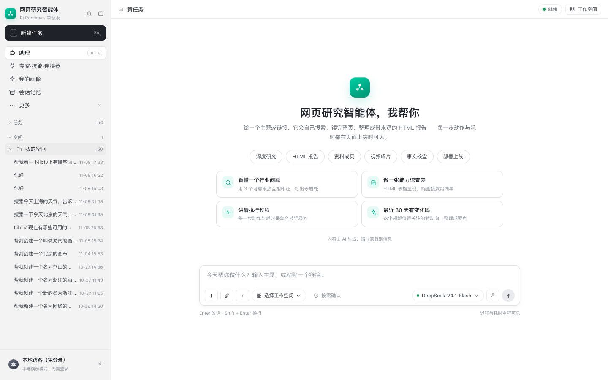
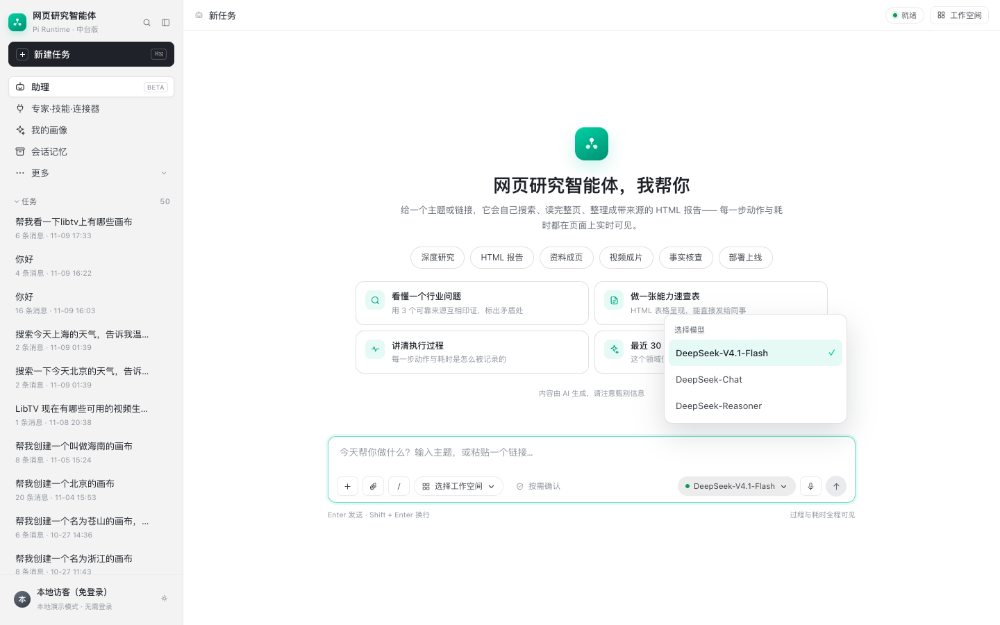

# 左侧栏、工作空间与模型选择

> 目标：拆解 WorkBuddy 左侧栏的「置顶 / 任务 / 空间」三段式与折叠、输入框里的「选择工作空间」和「模型选择」，并在本项目里实现同等效果。

## 1. 左侧栏：三个可折叠的大类

WorkBuddy 的侧栏是「三段式 + 计数 + 折叠」：

```
置顶 (3)        ⌄
  置顶的会话…
任务 (20)       ⌄
  会话列表（默认 20 条，查看更多）
空间 (4)        ⌄
  ▸ demo demo
  ▸ BeefTV
  ▸ Toonflow-app
  ▸ cli相关
```

设计点：

1. **每个大类都有计数和折叠箭头**，折叠后只留标题，侧栏不会被长列表撑满；
2. **任务默认只显示一页**（20 条），底部「查看更多」再展开，避免 50+ 条把「空间」挤到屏幕外；
3. **空间是文件夹**，每个空间可以单独展开/收起，展开后显示这个空间里的任务；
4. **空间右侧有「＋」**，新建空间；标题右侧有「展开全部」图标（WorkBuddy 的 `↗`）；
5. **置顶是横切分组**：置顶的会话从任务列表里抽出来放最上面，和任务分组用分隔线隔开。



## 2. 输入框里的「选择工作空间」

WorkBuddy 的「选择工作空间」不是一个普通下拉，而是**上下文绑定**：

- 工作空间 = 一个项目/画布（BeeFTV canvas）；
- 选中后把 `workspace_id`、`selected_ids` 写进请求；
- 发送消息时后端会重新读取画布最新内容，作为本轮上下文；
- 选择结果会写进 URL（`?workspace_id=...`），刷新/分享可恢复；
- 「新建画布」创建一个新的工作空间，再绑定；
- 只有平台登录、画布上下文验证通过后才允许发送。

本项目的对应实现：

- 输入框的 `#wsPill` 就是「选择工作空间」；
- `#workspace` 浮层里可选画布/新建画布/选节点/继续或停止任务；
- 通过 `/api/workspace`、`/api/workspace/context` 验证上下文；
- 需要 `<body data-workspace="true">` 才启用；没启用时点击会提示「画布上下文未启用」；
- 侧栏的「空间」是**本地文件夹**（localStorage），和画布工作空间是两套概念：前者归档会话，后者给模型提供上下文。

## 3. 模型选择

WorkBuddy 的模型选择是一个胶囊按钮：

```
[● DeepSeek-V4.1-Flash ⌄]
```

点开列出可用模型，当前项打勾；切换后下一轮对话使用新模型，选择会记住。

本项目实现：

- 输入框右侧 `#modelPill` 从静态文字改成按钮；
- 点开 `#modelMenu` 列出 `AVAILABLE_MODELS`；
- 选择后 `POST /api/models/select`，后端更新 `settings.llm_model` 并写入 `profile/model.json`；
- 进程启动时 `restore_model()` 恢复上次选择；
- 下一轮聊天/任务使用新模型（PiRuntime / LangGraph 都从 `settings.llm_model` 取）；
- 支持 `deepseek-v4-1-flash`、`deepseek-chat`、`deepseek-reasoner`（可在 `.env` 的 `AVAILABLE_MODELS` 增减）。



### 接口

```text
GET  /api/models          → {current, models:[{id,name}]}
POST /api/models/select   → {current, name}   请求体 {"id":"deepseek-chat"}
```

### 配置

```env
AVAILABLE_MODELS=deepseek-v4-1-flash,deepseek-chat,deepseek-reasoner
```

## 4. 本次改动

| 位置 | 改动 |
| --- | --- |
| 侧栏 | `置顶/任务/空间` 标题可点击折叠，带箭头和计数；状态存 `wb.groups.v1` |
| 任务列表 | 默认 20 条，底部「查看更多（N）」/「收起」 |
| 空间 | 保留文件夹展开/收起、新建空间、任务归属 |
| 模型 | 新增 `#modelPill` 菜单、`/api/models`、`/api/models/select`、`profile/model.json` |

## 5. 边界

- 模型切换是**进程级全局**（本地单用户够用），不是每个会话独立；多租户应改成会话级字段；
- 切换模型后正在跑的任务不会中途换模型，下一轮生效；
- 工作空间选择依赖 BeeFTV 画布；没有画布时，侧栏「空间」仍可用于本地归档；
- `AVAILABLE_MODELS` 必须与 `LLM_BASE_URL` 网关实际支持的模型一致，否则下一轮请求会失败。
