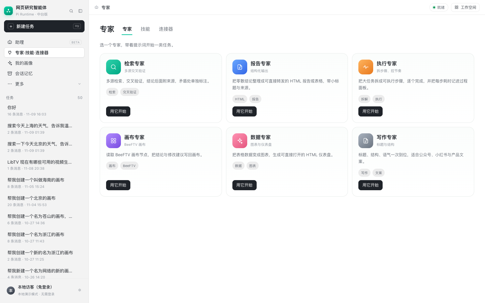
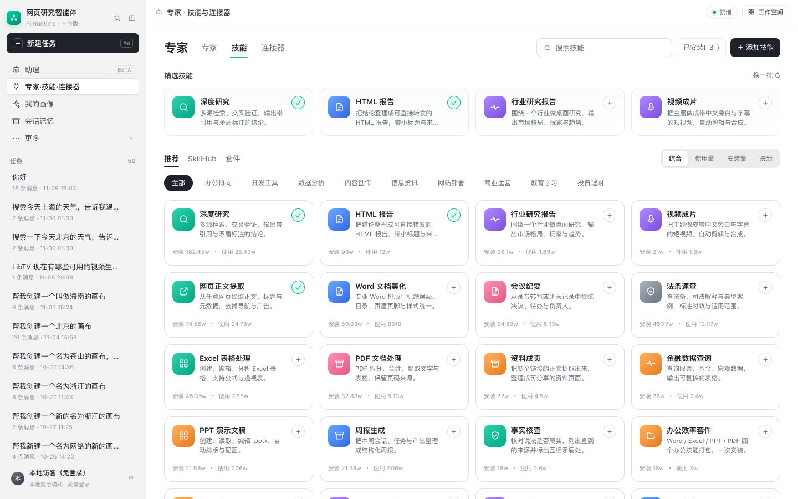
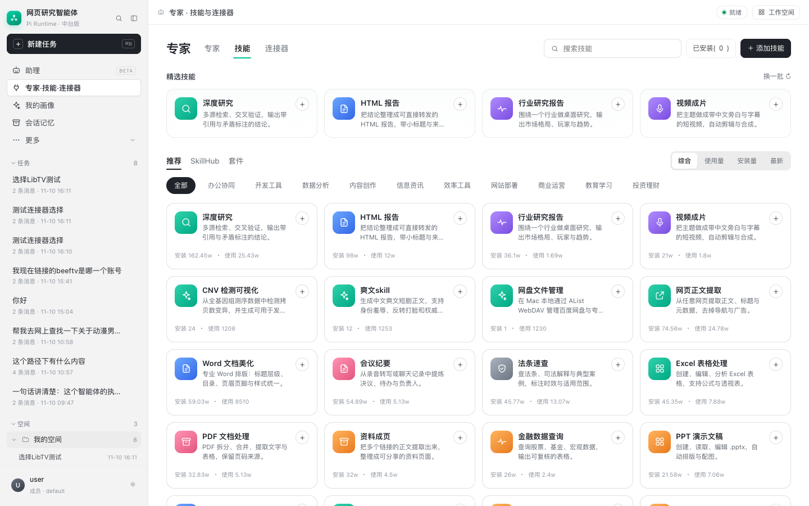
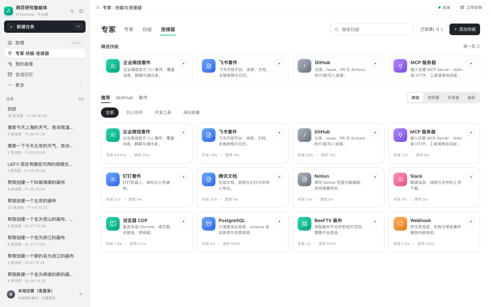
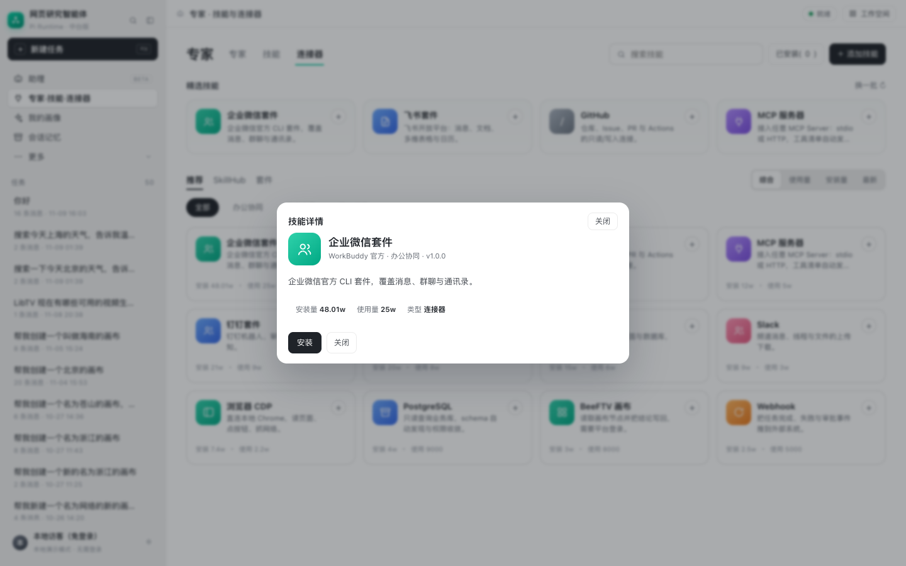

# 技能中心（SkillHub）设计与实现

> 目标：把 WorkBuddy 的「专家 · 技能 · 连接器」页面（含 SkillHub 市场、安装、分类、搜索、排序）复刻到本项目，
> 与现有 FastAPI 后端和单文件前端打通。

## 1. WorkBuddy 页面怎么设计

从截图拆解，这个页面是**主区整页**，不是弹窗：

```
顶栏：专家  [专家] [技能] [连接器]         搜索  已安装(3)  ＋添加技能
────────────────────────────────────────────────────────────
专家页（默认）：6 张专家卡片（检索/报告/执行/画布/数据/写作），点「用它开始」回会话
────────────────────────────────────────────────────────────
技能/连接器页：
  精选技能：4 张横向卡片（官方/热门）          换一批 ↻
  [推荐] [SkillHub] [套件]                   [综合][使用量][安装量][最新]
  [全部] [办公协同] [开发工具] [数据分析] [内容创作] [信息资讯] ...
  卡片网格（4 列）：icon  名称  ＋   简介   安装量/使用量   付费标记
```

关键设计点：

1. **三个一级 tab**：专家 / 技能 / 连接器；「专家」不是标题，而是可点击的工作方式列表。
2. **三层筛选**：来源（推荐/SkillHub/套件）→ 分类 → 排序；搜索与「已安装」是叠加过滤。
3. **精选与列表分离**：精选固定 4 张，横向，强调官方/热门；「换一批」轮换精选池。
4. **卡片信息密度低**：一行名称 + 两行简介 + 一行统计；安装按钮是右上角圆形 `+`，已安装变 `✓`。
5. **就地安装**：不跳详情页也能装；点卡片才进详情。
6. **跳转关系**：
   - 侧栏「专家 · 技能 · 连接器」→ 整页技能中心（默认专家页）；
   - 顶部「专家 / 技能 / 连接器」切换对象类型；
   - 「推荐 / SkillHub / 套件」切换目录来源；
   - 分类、排序、搜索、已安装都在同页刷新；
   - 专家卡片 / 技能卡片 → 详情或「用它开始」→ 回到会话并预填提示词；
   - 「添加技能」→ 表单弹窗，创建后自动安装。

## 2. 本项目实现

### 2.1 文件

| 文件 | 作用 |
| --- | --- |
| `src/webpage_agent/skillhub/catalog.py` | 本地种子目录：30 个技能 + 12 个连接器 |
| `src/webpage_agent/skillhub/store.py` | 安装状态持久化：`profile/skillhub/<tenant>__<user>.json` |
| `src/webpage_agent/skillhub/remote.py` | 远端目录拉取、5 分钟缓存、失败回退 |
| `src/webpage_agent/api/skillhub_api.py` | 客户端 API：列表、详情、安装/卸载、自定义技能 |
| `src/webpage_agent/api/skillhub_registry_api.py` | SkillHub 服务端 API：目录、详情、包下载 |
| `src/webpage_agent/api/routes.py` | 挂载 `skillhub_router` / `registry_router` / `registry_api_router` |
| `scripts/serve_api.py` | 未配置 `SKILLHUB_URL` 时注入本机默认地址 |
| `scripts/serve_skillhub.py` | 独立 SkillHub 服务（默认 8010），可单独部署 |
| `deploy/skillhub.registry.json` | 服务端种子数据（84 条：64 技能 + 20 连接器） |
| `src/webpage_agent/api/web/index.html` | 技能中心整页 + 详情/添加弹窗 |

### 2.2 API

| 方法 | 路径 | 说明 |
| --- | --- | --- |
| GET | `/api/skills` | 目录；参数 `kind=skill\|connector`、`tab=recommend\|skillhub\|suite`、`category`、`q`、`sort=comprehensive\|usage\|installs\|latest`、`installed=0\|1` |
| GET | `/api/skills/{id}` | 单个技能/连接器详情 |
| POST | `/api/skills/{id}/install` | 安装（幂等） |
| DELETE | `/api/skills/{id}/install` | 卸载 |
| POST | `/api/skills` | 新建自定义技能/连接器并自动安装 |
| GET | `/api/skillhub/v1/skills` | SkillHub 服务端目录（`page/page_size/kind/category/q/sort`） |
| GET | `/api/skillhub/v1/skills/{id}` | 服务端详情（含 `package.url/sha256/bytes`） |
| GET | `/api/skillhub/v1/skills/{id}/download` | 下载技能包 zip |
| GET | `/api/skillhub/registry` | 兼容接口：直接返回种子 JSON |
| GET | `/api/skillhub/status` | 当前远端地址与成功加载条数（排查用） |

返回结构：

```json
{
  "items": [ { "id": "...", "name": "...", "kind": "skill", "installed": false, ... } ],
  "featured": [ ... 4 条 ... ],
  "featured_pool": [ ... 8 条，供「换一批」轮换 ... ],
  "categories": [ { "name": "办公协同", "count": 12 } ],
  "total": 30,
  "installed_count": 3
}
```

技能条目字段：

```text
id, name, kind, icon, color, description, category, author,
installs, usage, featured, paid, source, suite, version, created, prompt, installed
```

### 2.3 前端状态

```js
state = { kind, tab, sort, category, q, installed, items,
          featured, featuredPool, featuredOffset, categories, installedCount }
```

- `loadHub()`：把筛选拼成 query，请求 `/api/skills`；
- `render()`：渲染精选（从 `featuredPool` 按 offset 取 4 条）、分类 chips、卡片网格、已安装计数；
- `switchHubKind(kind)`：专家 / 技能 / 连接器切换；专家页走 `renderExperts()`；
- `renderExperts()`：渲染 6 张专家卡；「用它开始」调用 `startExpert()` 回会话；
- `toggleInstall(item)`：POST/DELETE 后更新 `item.installed` 并重渲染；
- `openDetail(item)`：详情弹窗；技能可「用它开始」→ 关闭技能中心 → 预填 `#msg`；
- `openHub()/closeHub()`：切换 `.main.hub-mode`，同时同步侧栏高亮与面包屑。

### 2.4 导航

- 侧栏「专家 · 技能 · 连接器」→ `openHub('expert')`（默认落在专家页）；
- 「助理」或「新建任务」→ `closeHub()`；
- 点侧栏会话/空间任务 → 先 `closeHub()` 再打开会话；
- `Esc` → 依次关闭详情弹窗 / 添加弹窗 / 技能中心。

### 2.5 远端 SkillHub（SKILLHUB_URL）

WorkBuddy 的做法是：客户端 → SkillHub 服务端（列表 / 详情 / 下载 / 安装），客户端不直接读市场文件。

本项目现在也有这一层，而且 SkillHub 是**独立服务**，可以单独搬到服务器/域名：

- 启动独立服务：`python -m scripts.serve_skillhub --port 8010`（`serve_dev` 会自动启动）
- 服务端接口（独立服务根路径）：
  - `GET /v1/skills`：目录，支持 `page/page_size/kind/category/q/sort`
  - `GET /v1/skills/{id}`：详情，含 `package.url`、`package.sha256`、`package.bytes`
  - `GET /v1/skills/{id}/download`：下载 zip（`SKILL.md` + `manifest.json`）
  - `GET /v1/health`：健康检查
- 主应用内也挂了一份同构路由：`/api/skillhub/v1/...`（本地兜底）
- 客户端默认地址：`http://127.0.0.1:8010/v1/skills`
- 安装：下载 zip 到 `profile/skillhub/packages/<id>/<version>.zip`，校验 `sha256` 后才记录为已安装
- 缓存：目录缓存 `SKILLHUB_TTL` 秒（默认 300）；失败时回退上次缓存
- 元数据：`deploy/skillhub.registry.json` 是**服务端种子数据**，不是客户端直接读取的文件；真实部署可换 PostgreSQL / 对象存储
- 鉴权：可选 `SKILLHUB_TOKEN`；客户端与 SkillHub 配同一个值，请求带 `Authorization: Bearer`
- 当前总量：技能 **94**（30 本地 + 64 远端）、连接器 **32**（12 本地 + 20 远端）

**部署到服务器/域名（不改代码）**：

```bash
# 服务器上
python -m scripts.serve_skillhub --host 0.0.0.0 --port 8010
# nginx 把 https://skillhub.example.com/v1/ 反代到 127.0.0.1:8010
# 主应用 .env
SKILLHUB_URL=https://skillhub.example.com/v1/skills
SKILLHUB_TOKEN=同一个 token（可选）
```

重启主应用后，`/api/skillhub/status` 会显示新地址。

服务端种子数据的最小格式（`{"items": [...]}`）：

```json
{
  "version": 1,
  "items": [
    {
      "id": "github-issue-helper",
      "name": "GitHub Issue 助手",
      "kind": "skill",
      "category": "开发工具",
      "description": "根据报错起草 Issue。",
      "prompt": "根据下面的报错起草一个 GitHub Issue："
    }
  ]
}
```

只有 `id`、`name`、`kind` 必填；其余字段见 `catalog.py`。

## 3. 截图







## 4. 如何新增一个技能

在 `catalog.py` 的 `SKILLS` 里加一条：

```python
_item('my-skill', '我的技能', 'skill', '✨', '#e9faf5',
      '一句话说明这个技能做什么。', '效率工具',
      installs=0, usage=0, source='skillhub', created='2026-11-09',
      prompt='用它开始时要预填给模型的提示词：'),
```

重启服务后自动出现在目录里；前端不需要改。

## 4.1 远端 SkillHub

`remote.py` 支持两种目录形状：

```env
# 我们自己的 SkillHub（默认）
SKILLHUB_PROVIDER=native
SKILLHUB_URL=http://127.0.0.1:8010/v1/skills

# WorkBuddy / lightmake 风格
SKILLHUB_PROVIDER=workbuddy
SKILLHUB_URL=https://lightmake.site
SKILLHUB_REMOTE_LIMIT=300
```

WorkBuddy 形状的接口：

```text
GET /api/skills?page=&pageSize=&keyword=&category=
GET /api/v1/skills/{slug}?namespace=
```

本项目会把它归一化成内部的 `id/name/description/author/installs/usage/...`，
与本地种子目录合并；当前实测拉到 300 条远端技能 + 30 条本地技能，共 330 张卡片。

注意：

- 远端只保证**目录读取**；公开目录没有提供技能包下载地址，所以远端条目直接安装会失败；
- 需要可安装的远端时，配置 `SKILLHUB_PACKAGE_URL` 模板（`{slug}`、`{version}`），
  或把 `SKILLHUB_URL` 指向你自己的、带 `package.url/sha256` 的 SkillHub；
- 远端失败自动回退缓存/本地种子，不会让页面空白。


## 5. 安装状态

- 路径：`profile/skillhub/<tenant>__<user>.json`；
- 结构：`{"installed": ["deep-research", ...], "custom": [ ... ]}`；
- 写入用临时文件 + `os.replace`，避免半份 JSON；
- 当前默认主体已预装 3 个：`deep-research`、`html-report`、`web-extract`；
- 重置演示数据：

```bash
python - <<'PY'
from types import SimpleNamespace
from webpage_agent.skillhub import store
store.save(SimpleNamespace(tenant_id='default', user_id='default'),
           {'installed': [], 'custom': []})
PY
```

## 6. 与原「专家」弹窗的关系

原来的 `#expertModal`（专家/技能/连接器只读列表）保留在 DOM 里，但侧栏入口已改为整页技能中心。
如果还想保留旧入口，可以在「更多」菜单里加一个「专家面板」按钮调用 `openExperts()`。

## 7. 边界与下一步

- 目录已支持远端（native / workbuddy 两种形状），但远端安装依赖技能包地址；
- 安装目前只记录状态，不会自动注册工具；下一步可把已安装技能注入系统提示或工具白名单；
- 单机 JSON 适合当前部署；多副本/多租户应换 PostgreSQL 表；
- 需要 RBAC：普通用户只能安装，operator 才能上架/下架；
- 付费技能目前只是标记，未接支付与授权；
- 「用它开始」只预填 prompt，后续可绑定技能对应的工具集与参数。
