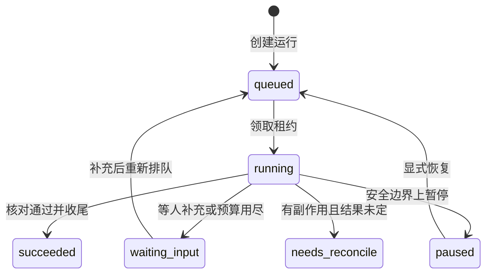

# 运行状态机

这篇把运行状态、观察决定、版本计数和失败分段收在一处。依据是当前代码：`src/webpage_agent/core/outcome.py` 的 `RUN_STATUSES`、`src/webpage_agent/core/schemas.py` 的 `ObservationDecision.DECISIONS`、`src/webpage_agent/store/pg_schema.py` 的版本列，以及 `src/webpage_agent/agent/graph.py` 的 `build_graph`。

这里说的状态是 `runs.status` / `tasks.status` 的通用词汇。步骤、动作、批准、后台作业、决策台账各自另有状态列，不在这张表里。展示词（`answered`、`local_ready`、`deployed`）由 `outcome.label()` 从通用状态和 outcome 推出来，不进状态机。

## 状态全集与派生集合

`RUN_STATUSES` 是封闭集合，当前 13 个值：

| 值 | 在派生集合里 |
|---|---|
| `queued` | `ACTIVE_RUN_STATUSES`、`RESUMABLE_RUN_STATUSES` |
| `running` | `ACTIVE_RUN_STATUSES` |
| `reconciling` | `ACTIVE_RUN_STATUSES` |
| `waiting_input` | `STOPPED_RUN_STATUSES`，并因此落在 `TERMINAL_RUN_STATUSES` |
| `waiting_approval` | `STOPPED_RUN_STATUSES`，并因此落在 `TERMINAL_RUN_STATUSES` |
| `waiting_external` | `STOPPED_RUN_STATUSES`，并因此落在 `TERMINAL_RUN_STATUSES` |
| `paused` | `STOPPED_RUN_STATUSES`、`RESUMABLE_RUN_STATUSES`，并因此落在 `TERMINAL_RUN_STATUSES` |
| `succeeded` | `TERMINAL_RUN_STATUSES` |
| `partially_succeeded` | `TERMINAL_RUN_STATUSES`、`ATTENTION_RUN_STATUSES` |
| `needs_reconcile` | `TERMINAL_RUN_STATUSES`、`ATTENTION_RUN_STATUSES` |
| `failed` | `TERMINAL_RUN_STATUSES` |
| `cancelled` | `TERMINAL_RUN_STATUSES` |
| `interrupted` | `TERMINAL_RUN_STATUSES`、`RESUMABLE_RUN_STATUSES` |

五个派生集合的算法不一样：

| 常量 | 怎么来的 | 成员 |
|---|---|---|
| `ACTIVE_RUN_STATUSES` | 手写 | `queued`、`running`、`reconciling` |
| `STOPPED_RUN_STATUSES` | 手写 | `paused`、`waiting_input`、`waiting_approval`、`waiting_external` |
| `TERMINAL_RUN_STATUSES` | **差集** `RUN_STATUSES - ACTIVE_RUN_STATUSES` | 除上面三个活跃值以外的全部，含暂停和等待 |
| `ATTENTION_RUN_STATUSES` | 手写 | `needs_reconcile`、`partially_succeeded` |
| `RESUMABLE_RUN_STATUSES` | 手写。`resume` 只接受这些 | `paused`、`interrupted`、`queued` |

`TERMINAL_RUN_STATUSES` 用差集，意味着往 `RUN_STATUSES` 里加一个新值时，只要没同时写进 `ACTIVE_RUN_STATUSES`，它会自动变成终态。它不会自动变成可领取、可恢复或可接受补充。领取条件是另一份手写列表（`queued` / `running` / `reconciling`），和 `ACTIVE_RUN_STATUSES` 目前一致，但是复制出来的，不是引用这份集合。

这里的「终态」是「这次执行不再往前推进」，不是「目标已经结束、也不能再回来」。`paused`、`waiting_input`、`waiting_approval`、`waiting_external` 既在 `STOPPED_RUN_STATUSES` 里，也在 `TERMINAL_RUN_STATUSES` 里。SSE 用终态集合判断要不要收流，所以停下来等人或等外部任务时连接也会结束。

`check_run_status` 只接受 `RUN_STATUSES`（历史展示词先经 `normalize_status` / `LEGACY_STATUS` 折进来）。越界时不抛异常：打一条 error 日志，返回 `failed`。调用方会把这个 `failed` 写进去，原来的非法值不会留在库里。

`LEGACY_STATUS` 只用于读旧数据，不是新状态：`answered` / `local_ready` / `deployed` / `compensated` 折成 `succeeded`，`deploy_needs_check` 折成 `needs_reconcile`。

图内部的 `AgentState.status` 还会出现 `planned` 和空字符串。它们不是 `RUN_STATUSES` 的成员。`run_task` 收尾时，不在 `TERMINAL_RUN_STATUSES` 里的值会先交给 `final_status` 重算，再经过 `check_run_status`。因此 `planned` 通常到不了 `runs.status`。

`waiting_external` **是** `RUN_STATUSES` 里的状态：`runs.status = 'waiting_external'` 表示 Pi 已退出、在等已受理的外部任务。`runs.waiting_external` 另外还有一个整数列，只做租约围栏（旧执行者不能把标记改回去），不是第二套状态词汇。以前把整数列写成「不是状态」，和代码里的 `RUN_STATUSES` 不一致；以状态值为准。

## 每个状态怎么进入、怎么离开

图的出边集中在 `build_graph`。状态赋值没有单一入口，节点、决定、接口和仓储都会写。下表只记稳定的进出，不把每一行赋值都列成边。

可以接受补充的状态是 `INPUT_ACCEPTING_STATUSES`：`queued`、`running`、`reconciling`、`paused`、`waiting_input`、`waiting_approval`。`needs_reconcile` 明确拒绝。`succeeded`、`failed`、`cancelled`、`interrupted`、`partially_succeeded` 一律按「已经结束」拒绝；其中 `cancelled` 的错误码是 `run_cancelled`，其余是 `run_finished`。

| 状态 | 进入 | 离开 |
|---|---|---|
| `queued` | 创建 run（新任务、补偿、手动部署）时的初值；领到了却没能执行时 `requeue_run_owned` 放回；租约失效且没有 `in_flight` 动作时对账放回；`resume` 先改回排队再领；批准通过；`waiting_input` 收到补充后重新排队；外部任务完成且当时停在 `waiting_input` | `claim_run` 变成 `running`。还没人领时暂停，同一事务直接变成 `paused` |
| `running` | `claim_run`。条件是当前为 `queued` / `running` / `reconciling`，且租约为空或已过期。成功时 `lease_epoch` 加 1 | 收尾写成下面各停住状态；安全边界上的暂停写成 `paused`；取消且没有未定动作写成 `cancelled`；执行器未捕获异常写成 `failed`；租约失效后对账写成 `queued` 或 `reconciling` |
| `reconciling` | 对账发现 `running` / `reconciling` 的租约已死，且有 `in_flight` 动作。那些动作先改成 `unknown`，run 改成这个状态 | 仍可被 `claim_run` 领回 `running`。下一步碰到未定动作后通常再进入 `needs_reconcile`。对 `reconciling` 发暂停只登记 `pause_requested`，不立刻改状态 |
| `waiting_input` | 预算用尽（上下文、运行次数、工具次数、决策次数、修订次数）；计划校验失败或模型没给出可执行步骤；决定是 `wait_input`，或修订候选没通过校验；`wait_async` 发现外部任务已受理；`planning_failure` 遇到预算类异常。Pi 路径：`request_input`，或同一工具参数连续校验失败 | 不走 `resume`。补充被接受后重新排队，回到 `queued`。外部任务失败时，若当时是 `waiting_input` / `running` / `queued`，会改成 `needs_reconcile` |
| `waiting_approval` | 决定是 `wait_approval`；执行步骤时授权层抛出 `ApprovalRequired`。Pi 路径：工具回执 `needs_approval`，快照 `phase=awaiting_approval` | 批准通过回到 `queued`。拒绝写成 `failed`。没有本机待批单时，补充也可以把它重新排队 |
| `waiting_external` | Pi 工具回执 `accepted`（远端已受理、结果未定），或恢复决策 `resume_wait` 且没有待审批。图路径的 `wait_async` 仍可能写成 `waiting_input`（见下），不把外部等待记成这个状态 | 外部任务完成后重新排队。失败改成 `needs_reconcile`。这是持久等待：收尾不写最终答复，避免占掉 `final:<run_id>` 去重键 |
| `paused` | `queued` 上调用暂停，直接改状态。`running` 上调用暂停只写 `pause_requested`，执行者在下一次准入前看到后，由 `pause_at_boundary` 写成 `paused` | `resume` 在没有未定动作时改回 `queued`。可以接受补充 |
| `succeeded` | `verify_completion` 判定完成条件已满足；或 `finalize` 调用 `final_status`：补偿计划没有失败、部署回执成功、有回答或产物、或计划里的步骤全部成功且副作用都已核实 | 停在这里。补充被拒绝，`resume` 不接受 |
| `partially_succeeded` | 完成条件有未满足项但已经有产物；要求核对失败或判定未完成；工具失败后补偿回滚也有失败 | 停在这里，属于 `ATTENTION_RUN_STATUSES`。补充按已结束拒绝。收尾时要求没有未处理补充 |
| `needs_reconcile` | 有副作用且执行确定性是 `unknown`；重复准入碰到 `in_flight` / `unknown`；工具已不可用且此前已标记要对账；有动作却没有计划；取消时仍有未定动作；部署回执不是成功；外部任务失败。旧值 `deploy_needs_check` 读取时也折到这里 | 不能 `resume`，不能接受补充。代码里没有「核实完成后自动离开」的迁移 |
| `failed` | 决定是 `stop`；依赖步骤没成功；参数或引用解析失败；没有调用资格；批准不可用或被拒绝；工具失败且不需要人工核实、补偿也没有失败；完成条件未满足且没有产物；执行器未捕获异常；`check_run_status` 收到非法值；补偿计划自身带失败 | 停在这里。补充按已结束拒绝，`resume` 不接受 |
| `cancelled` | 准入时已经有 `cancel_requested_at`；协作式取消且没有未定动作 | 停在这里。补充返回 `run_cancelled`。`resume` 明确不复活取消 |
| `interrupted` | `planning_failure` 遇到的不是预算类异常（规划、选工具、修订、观察预留或模型调用失败）；图递归步数用尽。另外，连接打开时 `_recover_orphans` 会把没有活租约的遗留 `tasks.status` 写成 `interrupted`，那一步只改任务行 | `resume` 接受，没有未定动作时回到 `queued`。补充却按已结束拒绝 |

`reconciling` 和 `needs_reconcile` 不是同一站。前者仍在 `ACTIVE_RUN_STATUSES` 里，Worker 还能领；后者要人核实，领不到，也补不了要求。

取消若碰上未定动作，run 写成 `needs_reconcile`。同一条 `CancelledError` 路径发出的状态事件仍写着 `cancelled`，而且不带 `run_status`。看事件和看 `runs.status` 会得到两个答案。

## 六种决定与状态的对应

观察之后模型能给出的结论定义在 `ObservationDecision.DECISIONS`。它是这个模型上的 `ClassVar` 元组，值按顺序为 `continue`、`revise`、`wait_input`、`wait_approval`、`finish`、`stop`。不是 `Enum`。`model_post_init` 拒绝元组以外的 `kind`，并检查分支必备字段：`revise` 必须有步骤，`wait_input` 必须有问题，`wait_approval` 必须有 `approval_scope`，`stop` 必须有 `stop_reason`。

决定只描述「下一步走图的哪条边」。run 状态是另一件事，有的决定根本不改它。

| 决定 | 图接下来去哪 | 对 run 状态 |
|---|---|---|
| `continue` | 还有剩余步骤就去 `run_step`；片段已经走完则改去 `verify_completion`，避免空转 | 不改 |
| `revise` | 候选通过校验后去 `persist_plan`。图状态会写成 `planned`，这不是十三个运行状态之一 | 校验失败则停在 `waiting_input`。通过校验不把 run 收成终态 |
| `wait_input` | 问题没问过：结束本轮图。同一组问题换措辞再问：改去 `verify_completion` | 新问题写成 `waiting_input` |
| `wait_approval` | 结束本轮图 | 写成 `waiting_approval` |
| `finish` | 去 `verify_completion`。完成由程序核对，不由这条决定宣布 | 不直接写成 `succeeded` |
| `stop` | 结束本轮图 | 写成 `failed`，已完成的步骤和产物保留 |

程序观察自己的路由在 `observe/observation.py`，先于模型决定。控制请求、要求版本变化、未定的写操作、已受理的外部任务，都不会先问模型。其中 `needs_reconcile` 和 `control` 两条路由在图上映射到结束，不进入 `decide_next`。

## 版本字段

容易混的是四个计数器。权威值都在 `runs` 这一行，彼此比的不是同一件事。

| 计数器 | 回答的问题 | 谁写 | 谁读 | 和另外三个的关系 |
|---|---|---|---|---|
| `lease_epoch` | 哪个执行者有权推进 | `claim_run` 在领取时加 1，从 0 起 | `_owned`、`update_run_owned`、续租、释放租约、`control_state`。不放进 `AgentState` | 不和另外三个比大小。代次或持有者不符先抛 `LeaseLost`，计划版本和要求版本的比较不会发生，业务列也不写 |
| `plan_version` | 当前采用哪一版计划 | `commit_plan` 设成刚提交的版本；`finish_run_owned` 可以带上同一列 | `run_intent`、`intake`、账本准入。步骤和动作行用它标明自己属于哪一版 | 提交时若带了 `base_plan_version`，且库里的 `plan_version` 不是 0、又和基数不同，抛 `IntentChanged`。异常类型与「要求变了」相同 |
| `intent_version` | 用户要求更新到哪一版 | 接受一条新补充时加 1，从 1 起。同一个 `request_id` 重放不加 | 准入、提交计划、收尾、预留决策，都要求「计划所依据的版本」与当前值相等 | 和 `plan_version` 独立。要求变了而计划还是旧的，旧动作不得再准入；已经发出的动作仍要结算 |
| `processed_intent_version` | 已提交计划覆盖到哪一版要求 | 只在 `commit_plan` 里用 `GREATEST` 推进到这份计划覆盖的 `intent_version`，默认 0 | `run_intent`、`intake`、补充接口的回读 | 不单独做相等比较。收尾门禁看的是还有没有 `accepted` 的补充行。它小于 `intent_version` 表示还有要求没写进计划 |

`commit_plan` 在同一事务里做这几件事：租约仍有效；`expected_intent_version` 等于 `runs.intent_version`；基数计划版本对得上；写入 `plans` 行；把更老计划里未执行的步骤标成 `superseded`；更新 `runs.plan_version` 与 `processed_intent_version`；把 `intent_version` 不超过覆盖版本的补充标成 `applied`。`applied` 只表示已经纳入计划，不表示业务做完。

`admit_action` 的比较是相等，不是「大于等于」。依据版本来自已提交计划上的 `intent_version`，不采用模型当场报的数。暂停或取消若先提交，这一步拿不到调用资格；这一步若先准入，该动作继续结算，后续不再派发。

`finish_run_owned` 同样比较 `expected_intent_version`。`succeeded`、`partially_succeeded`、`needs_reconcile` 收尾时还要求没有仍为 `accepted` 的补充，否则抛 `IntentChanged`，调用方回到图里修订，不把 run 标成结束。`waiting_input`、`failed`、`paused` 允许留下未处理补充。

快照上的 `plan_version`、`intent_version`、`processed_intent_version` 只给排障。恢复以 `runs` 上的值为准，因为补充可以先改 `runs.intent_version`，快照还没跟上。

这四个名字落在 `runs`、`plans`、`steps`、`actions` 上，一共 7 列：

| 表 | 列 |
|---|---|
| `runs` | `lease_epoch`、`plan_version`、`intent_version`、`processed_intent_version` |
| `plans` | `intent_version` |
| `steps` | `plan_version` |
| `actions` | `plan_version` |

同义但不同名、或抄在别的表上的列还有：`plans.version`（计划版本本身）、`plans.base_plan_version`、`actions.decision_intent_version`、`run_snapshots` 上的三份副本、`run_inputs.intent_version`、`run_decisions` 的 `intent_version` / `base_plan_version` / `committed_plan_version`、`run_input_processing.processed_plan_version`。`background_jobs.lease_epoch` 和 `external_tasks.poll_epoch` 是作业和外部任务自己的租约，不是这条 run 的 `lease_epoch`。

注释里的「三个版本」不是同一组。`pg_schema.py` 点名 `lease_epoch`、`intent_version`、`plan_version`。`run_intent` 读的是 `intent_version`、`processed_intent_version`、`plan_version`。`AgentState` 的注释说 `lease_epoch` 不进图状态。实际要分开记的是上面四个。

## 三套失败分段

失败相关的词有三套，互不包含，也不能用一套的值去查另一套。

### 工具错误阶段

`observe/errors.py` 的 `PHASES` 是元组，五个值：`validate`、`connect`、`dispatch`、`receive`、`decode`。配在 `ExecutionOutcome.phase` 上，和确定性 `not_executed` / `failed_confirmed` / `unknown` 一起用。确定性才决定能不能重试、要不要人工核实；阶段只说明失败发生在调用的哪一段。

`dispatch` 只出现在这个元组里，仓库里没有把它赋给 `phase` 的地方。远端工具失败时，`tools/core.py` 里那条调用通道用确定性二选一：`not_executed` 记成 `connect`，否则记成 `receive`。其它赋值点是：

| 值 | 谁在用 |
|---|---|
| `validate` | 本地校验、策略、授权、引用解析、上下文预算、运行预算 |
| `connect` | 检索/抓取还没连上；以及上面那条「未执行」的远端失败 |
| `receive` | `ModelRequestError` 的类属性；远端失败且确定性不是 `not_executed` |
| `decode` | `MCPToolFailure`：服务端回了业务失败回执，确定性是 `failed_confirmed` |
| `dispatch` | 没有赋值点 |

`ModelRequestError` 把确定性标成 `not_executed`，阶段却固定为 `receive`。它不走 `tools/core.py` 那条「未执行就记 connect」的分支。

`observe/observation.py` 里另有一个同名 `PHASES`，值是 `accepted`、`processing`、`completed`、`materialized`。那是工具结果走到哪一步，默认甚至会填 `completed`。它不描述失败，也不能拿去校验 `ExecutionOutcome`。

### 规划失败的 stage

`planning_failure` 的 `stage` 参数默认是 `plan`。调用点上写死的还有 `tool_selection`、`tool_selection_repair`、`revise`、`observe`。计划校验失败时还有一处直接构造 `planning_failure` 字典，`stage` 同样是 `plan`。

`run_step` 在只读工具遇到上下文预算或模型错误时，把**工具名**传进 `stage`。因此这列是开放集合，不是封闭枚举。新工具会带来新的 `stage` 值，文档和前端都不能假设只有上面那几个词。

这个 `stage` 会进 `planning_failure` 记录和 `errors` 列表。它不改变 `PHASES`，也不查 `STAGE_LABELS`。预算类异常把 run 收成 `waiting_input`，其它规划失败收成 `interrupted`。

### 阶段展示名

`observe/events.py` 的 `STAGE_LABELS` 有 18 个键，给耗时行和阶段事件做中文名。`label_of` 查不到就原样返回键，所以缺键不会报错，界面上会直接看到英文或工具名。

编排节点 10 个：`intake`、`plan`、`persist_plan`、`revise_plan`、`finalize`、`observe_result`、`decide_next`、`wait_async`、`verify_completion`、`run_step`。

写死的工具名 7 个：`web_search`、`fetch_pages`、`render_sources_html`、`answer_with_sources`、`answer_directly`、`deploy_site`、`manual_deploy`。动态 MCP 工具没有对应键。`manual_deploy` 在这份字典之外没有引用。

另有合成阶段 `instruction`（收到指令到开始执行）。界面不单独展示它，后端仍记在 `timings` 里。

`usage` 和 `errors` 里的 `stage` 又是开放字符串。代码里出现过的包括 `plan`、`tool_selection`、`tool_selection_repair`、`revise`、`revise_repair`、`revise_no_repeat`、`observe`、`request_plan_review`、`request_result_review`、`boundary`、`runtime`、`search`、`extract`。它们和上面三套都不保证同步。

## 主路径

运行状态只画主路径。`failed`、`cancelled`、`waiting_approval`、`interrupted`、`partially_succeeded`、`reconciling` 的进出见上面的表。



图节点的主路径是一条直线，观察和决定是中途分叉，不在这张状态图里展开：

```text
intake → plan → persist_plan → run_step → observe_result → verify_completion → finalize
```

`build_graph` 里的条件边：

- `intake` 去 `plan`、`revise_plan`、`run_step` 或 `verify_completion`
- `plan` 固定去 `persist_plan`
- `persist_plan` 去 `revise_plan`、`run_step`、`verify_completion` 或结束
- `revise_plan` 去 `persist_plan`、`verify_completion` 或结束
- `run_step` 固定去 `observe_result`
- `observe_result` 去 `run_step`、`revise_plan`、`decide_next`、`verify_completion`、`wait_async` 或结束
- `decide_next` 去 `run_step`、`persist_plan`、`verify_completion` 或结束
- `verify_completion` 去 `decide_next`、`finalize` 或结束
- `finalize` 去 `revise_plan` 或结束

`wait_async` 没有出边。走进这个节点后，本轮图执行到此为止，返回值里的 `waiting_input` 由执行器收尾落库。

文件顶部的控制流注释还写着 `revise_plan` 直接去 `persist_plan`、`persist_plan` 不去 `revise_plan`。以 `build_graph` 的条件边为准。

## Pi 工具循环与图语义

新建业务 run 的默认引擎是 Pi（`settings.default_runtime_kind`，未设置 `DEFAULT_RUNTIME_KIND` 时为 `pi`）。恢复仍读该 run 已存的 `runtime_kind`：LangGraph 的 run 继续走图，不会因为默认切换被重跑。

Pi 不是图。它不实现 `plan` / `revise_plan` / `verify_completion` 这些节点，也不在工具循环里假装有步骤游标。画布主路径是：

`创建任务 → claim → PiRuntime → 工具经 governed_call → 检查点/快照 → 等待或终态`

和画布有关的等待：

| 宿主状态 | Pi 怎么进入 | 怎么离开 |
|---|---|---|
| `waiting_input` | 模型调用宿主工具 `request_input`，或同一工具参数连续两次校验失败 | 补充输入后 `_pi_resume_plan` 把停靠的 tool result 交付回去，再继续工具循环。没有新输入则 `resume_wait_input`，不重跑、不报成功 |
| `waiting_approval` | 授权层 `needs_approval` | 批准后 `resume_admit` 重放原调用；拒绝或过期转 `needs_reconcile` |
| `waiting_external` | 工具回执 `accepted` | 外部任务完成后 `resume_deliver` 注入结果。Pi 崩溃不自动重放未定调用 |
| `succeeded` / `needs_reconcile` | 有答复，或平台写经 `platform_verify` 回读 | 写证据不齐是 `needs_reconcile`，不能靠模型解释文本收成成功 |

Pi **不做**多步 `compensate`，也**不做**「点一下部署」那条一步图计划。这两条都显式新建 `runtime_kind=langgraph` 的 run：补偿把已成功且声明了 `compensate` 的步骤翻成撤销计划；部署把上一次产物收成单步 `deploy`。不要在 Pi 上留同名空接口。原 run 的引擎不变。

补充要求若在收尾时才进来，下一轮必须走 `_resume_for_engine`。Pi 不能改读图的 `plans/steps`，否则快照被丢掉，已执行的工具会再跑一遍。显式 `resume` 同样不把「有动作、没有图计划」当成异常：那是 Pi 的正常形态。图路径仍拒绝这种组合。

写工具默认关闭。`PI_WRITE_TOOL_KEYS` 只有在 `PI_WRITE_TOOLS_ENABLED=true` 时才并入白名单，并写审计日志。只配键、不开开关，键被忽略。

## 已知问题与后续

1. 运行状态的写入分散在 `agent/nodes.py`、`agent/decide.py`、`api/`、`store/`，另外 `core/external_tasks.py` 会写成 `needs_reconcile` 或 `queued`，批准通过/拒绝会写成 `queued` 或 `failed`。按十二个状态字面量粗查，节点、决定、接口、仓储大约分别是 28、12、39、23 处；`status=某个变量` 还不在这些数字里。图的边已经集中在 `build_graph`。这次只把事实记下来，不合并写入点。
2. 新状态会自动进入 `TERMINAL_RUN_STATUSES`，却不会自动进入领取、恢复或接受补充的那几份手写列表。差集和手写列表各管各的，加一个值很容易变成「既不跑、也回不来」。
3. `interrupted` 可以 `resume`，但不能接受补充。`waiting_input` 相反：不能 `resume`，靠补充重新排队。名字都像「停下来等」，离开方式不同。
4. 连接打开时 `_recover_orphans` 把没有活租约的遗留任务写成 `tasks.status = interrupted`。run 的遗留处理是另一个函数 `reconcile_orphan_runs`，把租约已死的 run 写成 `queued` 或 `reconciling`。任务上的 `interrupted` 不等于 run 上的 `interrupted`。
5. 同一会话是否还占着目标，用的是更窄的一张表：只把 `succeeded`、`partially_succeeded`、`failed`、`cancelled` 排除。`paused`、`waiting_input`、`needs_reconcile`、`interrupted` 仍会挡住这条会话上的新目标。这和 `TERMINAL_RUN_STATUSES` 不是同一份名单。
6. `verify_completion` 在存在未检查条件时，事件文案写「按部分完成报告」，接着仍把状态设为 `succeeded`，除非后续的要求核对失败。部分完成这个状态要看 `partially_succeeded` 的赋值，不能看这句文案。
7. 登录失效时 SSE 会发 `status` 为 `interrupted` 的结束帧，不修改 `runs.status`。
8. `dispatch` 没有赋值点；`planning_failure.stage` 会吃进工具名；`STAGE_LABELS` 写死了当前能力包的工具名，还留着没有引用的 `manual_deploy`。三套词表要分开改。
9. `pg_schema.py` 和 `run_intent` 的注释仍把版本说成三个，而且两处点名的成员不一样。状态以 `RUN_STATUSES` 的 13 个值为准（含 `paused` 与 `waiting_external`），版本以本节的四个计数器为准。`docs/README.md` 第 4 节的个数已与这 13 个值对齐，细节以本页为准。
