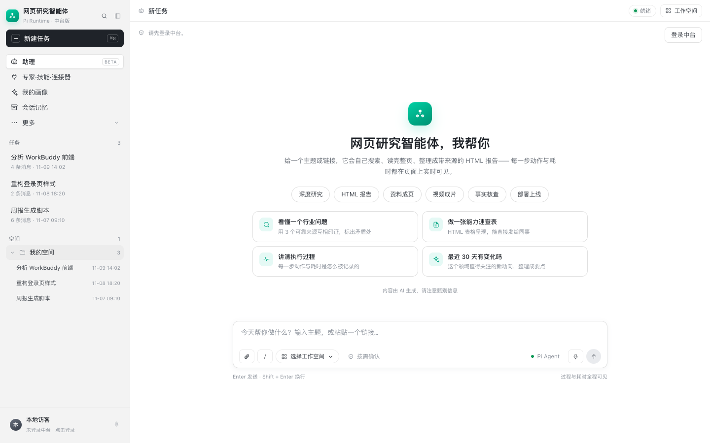
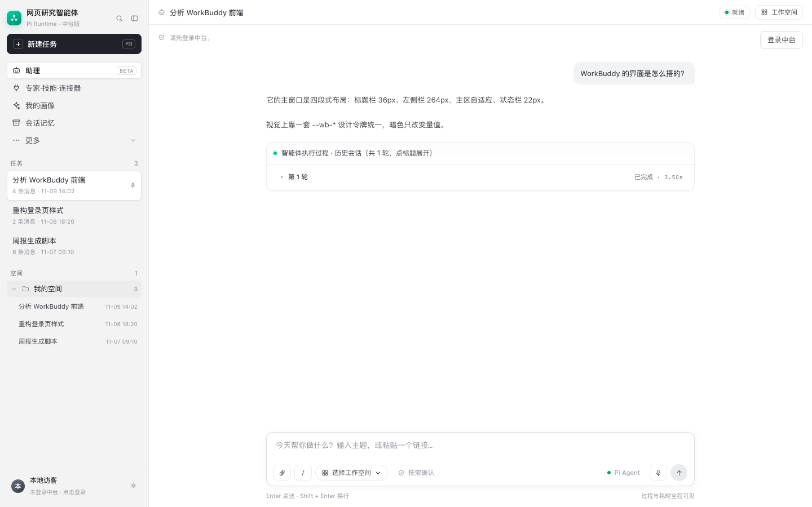

# WorkBuddy 风格前端改造说明

> 产物：`src/webpage_agent/api/web/workbuddy.html`（新文件，不覆盖现有 `index.html`）
> 方式：在原单文件页面上追加一层 WorkBuddy 设计覆盖（`<style id="wb-workbuddy-theme">`），**JS / API / 路由全部不动**。

## 1. 为什么这么做

你现有的 `index.html` 已经具备完整的会话、SSE、任务、空间、画像/记忆/管理等功能，而且结构本来就参考了 WorkBuddy。直接重写会丢功能、也会碰你正在改的代码。所以这次做的是**设计系统替换**：

- 保留全部 DOM 结构与 JS 行为；
- 只替换颜色、字号、间距、圆角、阴影、侧栏宽度、按钮样式；
- 新增文件，可随时对比/回滚。

## 2. 设计映射（WorkBuddy 5.9.2 → 本页）

| 项目 | 改造前 | 改造后 |
| --- | --- | --- |
| 品牌色 | 橙红 `#ef4b36` / 渐变橙 | 青绿 `#00c29a`，hover `#00a884` |
| 侧栏 | 248px，`#f7f7f8` | 264px，`#f3f3f3`，右边框 `#e8e8e8` |
| 顶栏 | 52px | 44px |
| 正文字号 | 14px | 13px / 20px |
| 新建任务 | 白底描边 | 深色实底 `#1f2329` + 白字，36px 高、8px 圆角 |
| 导航项 | 34px、9px 圆角 | 30px、6px 圆角 |
| 会话项 | 7px 内边距 | 6px 内边距、6px 圆角 |
| 欢迎标题 | `clamp(25,2.4vw,32)` | 26px / 600 |
| 场景标签 | 34px 高 | 32px 高、12px 字 |
| 建议卡 | 14px 圆角 | 12px 圆角、更紧凑 |
| 消息气泡 | 14px 字 | 13px 字、12px 圆角 |
| Composer | 18px 圆角、820px 宽 | 12px 圆角、760px 宽，聚焦青绿描边 |
| 发送按钮 | 灰底 / 黑底 | 灰底 → 可发送时青绿 `#00c29a` |
| 过程卡 / 结果卡 | 14px / 13px 圆角 | 12px 圆角 |
| 滚动条 | 8px 灰色 | 8px 更细、`#d8dbe0` |

## 3. 怎么预览

### 方式 A：直接对比（推荐先看）

```bash
cd "/Users/latiao/Desktop/demo demo/main_branch/src/webpage_agent/api/web"
# 临时把新页面作为首页（原文件先备份）
cp index.html "index.legacy-$(date +%Y%m%d-%H%M).html"
cp workbuddy.html index.html
# 重启 uvicorn 后访问 http://127.0.0.1:8000/
```

回滚：

```bash
cp "index.legacy-YYYYMMDD-HHMM.html" index.html
```

### 方式 B：加一个 `/workbuddy` 路由（可选，需改 routes.py）

在 `routes.py` 的 `index()` 旁边加：

```python
@app.get('/workbuddy', response_class=HTMLResponse)
async def workbuddy_ui():
    return HTMLResponse((WEB_DIR / 'workbuddy.html').read_text(encoding='utf-8'),
                        headers={'Cache-Control': 'no-store, must-revalidate'})
```

重启后访问 `http://127.0.0.1:8000/workbuddy`，两个页面可以并排对比。

## 4. 改了哪些选择器

覆盖层在 `workbuddy.html` 的 `<style id="wb-workbuddy-theme">` 里，按顺序：

1. `:root` 令牌（颜色/圆角/侧栏宽度/阴影）；
2. `body` 字号；
3. 侧栏（`.sidebar`、`.brand-mark`、`.new-task`、`.nav-item`、`.session-item`、`.side-foot`）；
4. 顶栏（`.topbar`、`.crumb`、`.conn`、`.ghost`/`.btn`）；
5. 欢迎/空态（`.welcome`、`.hero-mark`、`.chip`、`.sug`）；
6. 消息（`.msg`、`.bubble`、`.process-card`、`.card`）；
7. Composer（`.composer`、`#msg`、`.cbtn`、`.send-btn`）；
8. 弹层（`.modal-card`、`.tabs`、`.xcard`）；
9. 残留橙色替换（`.brand-mark`、`.hero-mark`、`.sug-ico`、`.xcard .x-ico`、`.process-head .dot`、`.auth-alt a`）。

## 5. 没改什么

- 所有 `fetch` / `EventSource` / SSE 事件处理；
- 登录、OIDC、平台票据、管理面板；
- 会话列表 / 时间线 / 任务 / 空间 / 画像 / 记忆的 JS 逻辑；
- 后端路由与数据模型（本次零后端改动）。

## 6. 建议的下一步

1. **先看效果**：按方式 A 或 B 预览，确认方向后再决定是否替换 `index.html`。
2. **暗色主题**：WorkBuddy 支持明暗；当前页面只有 light。可以下一步加 `[data-theme="dark"]` 覆盖（约 30 条规则）。
3. **组件化**：如果页面继续变大，把 `workbuddy.html` 拆成 `tokens.css` + `layout.css` + `components.css`，或迁到 Vite/React。
4. **细节对齐**：如果要把首页做得更像 WorkBuddy，可以减少 welcome 区的 hero 与建议卡，改成「问候 + 场景标签 + Composer」的居中结构。

## 7. 预览截图



