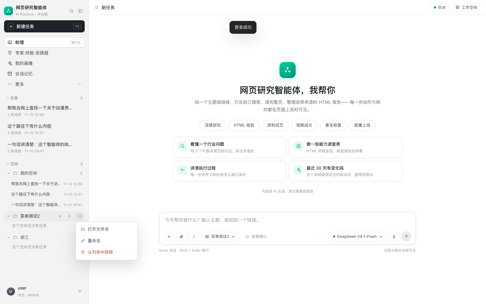

# 工作空间文件夹行：WorkBuddy 行为与本项目实现

## 1. WorkBuddy 文件夹行

左侧每个工作空间是一行：

```
[文件夹图标] Toonflow-app        [＋] [⋯]
```

- **＋（新建任务）**：在这个工作空间里开启一条新对话，工作空间作为本轮任务的上下文根。
- **⋯ → 打开文件夹**：在系统文件管理器（Finder/Explorer）里打开这个工作空间目录。
- **⋯ → 重命名**：改工作空间的显示名称。
- **⋯ → 从列表中移除**：只把它从侧栏/最近列表移除，不删除磁盘上的文件夹和文件。

背后的数据模型通常是：

```text
workspace = {
  id, name, path,
  last_opened_at,
  tasks / threads -> 关联到这个 workspace
}
```

WorkBuddy 是 Electron，主进程可以直接：

- `shell.openPath(path)` 打开文件夹；
- `fs` 重命名目录或改元数据；
- 应用数据库里维护 workspace/thread 关系。

浏览器没有这些能力，所以 Web 版需要后端代做。

## 2. 本项目的实现

### 2.1 新建任务（＋）

点击文件夹行的 `＋`：

1. 设为当前空间；
2. 如果是服务端工作空间，调 `POST /api/workspace/select`；
3. 调用前端 `newSession()` 清空当前会话，进入新任务状态。

任务真正创建仍在第一次发送消息时发生。

### 2.2 打开文件夹

```text
POST /api/workspace/open
{ "name": "Toonflow-app" }
# 或本地文件夹
{ "path": "/Users/me/work" }
```

后端：

- 只允许打开当前用户私有目录内的命名空间，或当前用户已绑定的那个本地目录；
- macOS 用 `open`，Windows 用 `os.startfile`，Linux 用 `xdg-open`；
- 不接受任意服务器路径，避免打开别人的目录。

### 2.3 重命名

```text
POST /api/workspace/rename
{ "name": "Toonflow-app", "new_name": "Toonflow" }
```

当前实现只改工作空间的**显示名称**（目录里的 `.space-name` 标记），不移动目录、不碰文件。默认的「我的空间」不允许重命名。

### 2.4 从列表中移除

不删除目录，只做“从列表隐藏”：

- 服务端命名空间：加入当前用户的隐藏集合
  `wb.hidden.v2.<user_id>`；
- 本地文件夹空间：从本地列表删除；
- 文件、目录、历史任务全部保留。

这样和 WorkBuddy 的“从列表中移除”语义一致：移除的是入口，不是数据。默认的「我的空间」不可重命名、不可移除，避免把根空间弄丢。

## 3. 前端细节

- 行悬停出现 `＋` 和 `⋯`；
- `⋯` 用 fixed 定位的浮层，靠近按钮展开；
- 点击外部或按 Escape 关闭；
- 重命名/移除后立即重绘侧栏；
- 所有状态按登录用户分键，不跨账号共享。



## 4. 接口一览

| 接口 | 作用 |
|---|---|
| `POST /api/workspace/namespace` | 新建命名工作空间 |
| `POST /api/workspace/select` | 切换当前工作空间 |
| `POST /api/workspace/open` | 在文件管理器打开 |
| `POST /api/workspace/rename` | 重命名显示名称 |
| `POST /api/workspace/pick` | 选择本机文件夹 |
| `DELETE /api/workspace` | 回到自动分配的私有目录 |

## 5. 边界

- “打开文件夹”只在**服务端和浏览器同一台机器**时符合直觉；远端部署时它打开的是服务器上的目录；
- “从列表中移除”是软隐藏，不删除数据；换浏览器后隐藏集合不会同步（目前按浏览器用户分键）；
- 重命名只改标签，不移动目录；
- 服务端只允许打开当前用户自己的私有目录或已绑定路径，避免越权。
